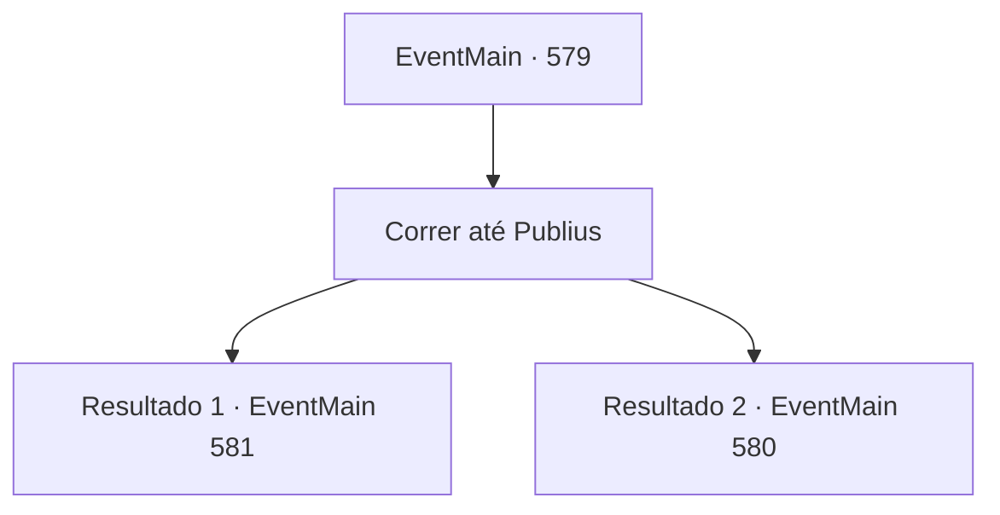

# Eventos principais · 579

[Índice da tabela](index.md) · [Índice geral](../index.md)

ID: `pt:EventMain:579` · Fonte: `EventMain4` · Versão: 1.2.47.

Mapeamento estático dos arquivos; a disponibilidade e a execução dependem do estado da run.

## Texto do evento

*Sem texto no arquivo.*

## Dados de entrada

```json
{
  "id": 579,
  "grade": 1,
  "normalGoal": "",
  "required": ""
}
```

## Mapa das escolhas



## Escolhas e resultados

### Escolha 1

Correr até Publius

Requisitos e outros campos da escolha:

```json
{
  "required": ""
}
```

#### Resultado 1.1

Você corre em direção a Publius quase como se estivesse se jogando fora. Enquanto isso, uma luz quente começa a vazar de seu corpo. Você suporta o calor e agarra seu rosto e retira sua alma. <link=shake>

 "Ar..Arg.."

</link> Ele grita de dor ao perder sua alma. Você não solta a dor ardente. Finalmente, você retira a alma de Publius. Quando Publius morre, a luz desaparece e o calor diminui. 

 "Nós... vencemos...!"

 Os adoradores aplaudem o grito de Gess. Você tropeça e oferece a alma de Publius a Kior, Então, Kior diz com uma grande risada. 

 "Khahahaha!! Isso é excelente!! Eu posso sentir minha energia se enchendo."

 Kior, que irrompe em risadas, continua a falar novamente. 

 "Agora... A queda de Tere não está longe... Primeiro de tudo, usaremos este lugar como base... Tente reunir mais dos meus adoradores."

 Ele diz que precisamos expandir seu poder para destruir completamente Teretian.

Continuação registrada: [Evento 581](0581.md) na mesma tabela.

```json
{
  "required": "",
  "chance": "1|0_6_1",
  "nextEvent": 581,
  "type": 0,
  "reward": "0_0_-1"
}
```

#### Resultado 1.2

Você corre até Publius. Mas antes mesmo de alcançá-lo, uma grande explosão e calor emanam dele. É tão brilhante que você não consegue olhar para ele, e o calor intenso aquece rapidamente, derretendo você. Quando você para, Kior te instiga. 

 "Ele está queimando sua alma pela última vez! O que diabos você está fazendo? Retire a alma dele!"


Continuação registrada: [Evento 580](0580.md) na mesma tabela.

```json
{
  "required": "",
  "chance": "18",
  "nextEvent": 580,
  "type": 1,
  "reward": "0_0_-1"
}
```

## Referências que chegam a este evento

- [Evento 578 · escolha 1 · resultado 1](0578.md#escolha-1)
