# Eventos principais · 580

[Índice da tabela](index.md) · [Índice geral](../index.md)

ID: `pt:EventMain:580` · Fonte: `EventMain4` · Versão: 1.2.47.

Mapeamento estático dos arquivos; a disponibilidade e a execução dependem do estado da run.

## Texto do evento

*Sem texto no arquivo.*

## Dados de entrada

```json
{
  "id": 580,
  "grade": 1,
  "normalGoal": "",
  "required": ""
}
```

## Mapa das escolhas

```mermaid
flowchart TD
  E["EventMain · 580"]
  C0["Bloquear a luz"]
  E --> C0
  R0_0["Resultado 1 · EventMain 583"]
  C0 --> R0_0
  R0_1["Resultado 2 · EventMain 583"]
  C0 --> R0_1
  R0_2["Resultado 3 · EventMain 583"]
  C0 --> R0_2
  R0_3["Resultado 4 · Destino especial -1"]
  C0 --> R0_3
  C1["Recuar"]
  E --> C1
  R1_0["Resultado 1 · EventMain 583"]
  C1 --> R1_0
  R1_1["Resultado 2 · EventMain 583"]
  C1 --> R1_1
  R1_2["Resultado 3 · Destino especial -1"]
  C1 --> R1_2
  C2["Resistir a dor"]
  E --> C2
  R2_0["Resultado 1 · EventMain 583"]
  C2 --> R2_0
  R2_1["Resultado 2 · Destino especial -1"]
  C2 --> R2_1
  R2_2["Resultado 3 · EventMain 581"]
  C2 --> R2_2
  R2_3["Resultado 4 · Destino especial -1"]
  C2 --> R2_3
  C3["Magia: Muralha de Ferro"]
  E --> C3
  R3_0["Resultado 1 · EventMain 581"]
  C3 --> R3_0
  R3_1["Resultado 2 · EventMain 583"]
  C3 --> R3_1
  R3_2["Resultado 3 · Destino especial -1"]
  C3 --> R3_2
  R3_3["Resultado 4 · EventMain 581"]
  C3 --> R3_3
```



## Escolhas e resultados

### Escolha 1

Bloquear a luz

Requisitos e outros campos da escolha:

```json
{
  "required": "20_9_2"
}
```

#### Resultado 1.1

Você bloqueia a luz e espera desaparecer. Uma grande quantidade de calor é despejada sobre você, mas você consegue resistir. A luz quente diminui e você olha ao redor. Os corpos dos paladinos mortos, os adoradores do demônio e Publius foram todos queimados até virarem cinzas. <link=shake>

 "Seu lixo! A alma de Publius desapareceu completamente!"

</link> Naquele momento, você se sente entorpecido com a repreensão de Kior. Essa é a sua voz realmente assustadora, diferente da voz doce que você já ouviu antes. 

 "Como você ousa me ignorar? Todos os meus adoradores morreram por causa da sua escolha tola, e você deve pagar por isso!"


Continuação registrada: [Evento 583](0583.md) na mesma tabela.

```json
{
  "required": "20_8_-2",
  "chance": "1|0_13_1",
  "nextEvent": 583,
  "type": 0,
  "reward": ""
}
```

#### Resultado 1.2

Você bloqueia a luz e espera desaparecer. Uma grande quantidade de calor é despejada sobre você, mas você consegue resistir. A luz quente diminui e você olha ao redor. Os corpos dos paladinos mortos, os adoradores do demônio e Publius foram todos queimados até virarem cinzas. <link=shake>

 "Seu lixo! A alma de Publius desapareceu completamente!"

</link> Naquele momento, você se sente entorpecido com a repreensão de Kior. Essa é a sua voz realmente assustadora, diferente da voz doce que você já ouviu antes. 

 "Como você ousa me ignorar? Todos os meus adoradores morreram por causa da sua escolha tola, e você deve pagar por isso!"


Continuação registrada: [Evento 583](0583.md) na mesma tabela.

```json
{
  "required": "21_8_-2",
  "chance": "1",
  "nextEvent": 583,
  "type": 2,
  "reward": ""
}
```

#### Resultado 1.3

Tentas bloqueá-lo, esperando que a luz desapareça. Mas o intenso calor não é algo que possas bloquear, e acabas com queimaduras. Consegues suportar a intensa dor. A luz quente diminui, e olhas à tua volta. Os corpos dos paladinos mortos, os adoradores do demónio e Publius foram todos reduzidos a cinzas. <link=shake>

 "Seu imbecil! A alma de Publius desapareceu completamente!"

</link> Nesse momento, sentes-te entorpecido com a repreensão de Kior. Essa é a sua verdadeira voz arrepiante, diferente da doce voz que ouviste antes. 

 "Como te atreves a ignorar-me? Todos os meus adoradores morreram por causa da tua escolha tola, e terás de pagar por isso!"


Continuação registrada: [Evento 583](0583.md) na mesma tabela.

```json
{
  "required": "1_0_2|20_8_-2",
  "chance": "20",
  "nextEvent": 583,
  "type": 1,
  "reward": "0_0_-1"
}
```

#### Resultado 1.4

Você tenta bloqueá-lo, esperando que a luz desapareça. No entanto, o grande calor não é algo que possa ser bloqueado. Seu corpo queima em cinzas instantaneamente.

Continuação registrada: [Destino especial `-1`](../destinos-especiais.md).

```json
{
  "required": "20_8_-2",
  "chance": "20",
  "nextEvent": -1,
  "type": 1,
  "reward": "0_0_-1|15_5_13|15_5_15|15_5_21"
}
```

### Escolha 2

Recuar

Requisitos e outros campos da escolha:

```json
{
  "required": ""
}
```

#### Resultado 2.1

Você rapidamente sai da cena, dá um passo para trás e se esconde. Logo, uma luz enorme pisca e desaparece. Você volta para onde Publius estava. Então, o calor intenso te recebe. O chão derreteu. Os corpos dos paladinos mortos, os adoradores do demônio e Publius foram todos queimados até virarem cinzas. <link=shake>

 "Seu lixo! A alma de Publius desapareceu completamente!"

</link> Naquele momento, você se sente entorpecido com a repreensão de Kior. Essa é a sua voz realmente assustadora, diferente da voz doce que você ouviu antes. 

 "Como você ousa me ignorar? Todos os meus adoradores morreram por causa da sua escolha tola, e você deve pagar por isso!"


Continuação registrada: [Evento 583](0583.md) na mesma tabela.

```json
{
  "required": "",
  "chance": "1|0_6_1",
  "nextEvent": 583,
  "type": 0,
  "reward": ""
}
```

#### Resultado 2.2

Você rapidamente sai da cena e tenta se esconder. Mas a luz chega até você mais rápido do que isso, então você se queima. Você fica preso em um buraco enquanto rola no chão com dor extrema. E em pouco tempo, a luz se apaga. 

 Você recupera os sentidos e volta para onde Publius estava. Então o calor intenso te recebe. O chão derreteu. Os corpos dos paladinos mortos, os adoradores do demônio e Publius foram todos queimados até virarem cinzas. <link=shake>

 "Seu lixo! A alma de Publius desapareceu completamente!"

</link> Naquele momento, você sente um formigamento com a repreensão de Kior. Essa é a sua voz assustadora de verdade, diferente da voz doce que você ouviu antes. 

 "Como você ousa me ignorar? Todos os meus adoradores morreram por causa da sua escolha tola, e você deve pagar por isso!"


Continuação registrada: [Evento 583](0583.md) na mesma tabela.

```json
{
  "required": "1_0_2",
  "chance": "20",
  "nextEvent": 583,
  "type": 1,
  "reward": "0_0_-1"
}
```

#### Resultado 2.3

Você rapidamente sai da cena e tenta se esconder. Mas a luz chega até você mais rápido do que isso, então você se queima. Depois de lutar com grande calor, O flash branco cobre tudo, e você queima até a morte no final.

Continuação registrada: [Destino especial `-1`](../destinos-especiais.md).

```json
{
  "required": "2_0_2",
  "chance": "20",
  "nextEvent": -1,
  "type": 1,
  "reward": "0_0_-1|15_5_13|15_5_15|15_5_21"
}
```

### Escolha 3

Resistir a dor

Requisitos e outros campos da escolha:

```json
{
  "required": ""
}
```

#### Resultado 3.1

Tentas aproximar-te de Publius enquanto suportas a dor. Mas à medida que a carne queima, o fumo sobe, O clarão é tão forte que os teus olhos vão arder. Eventualmente, agarras nos teus olhos e foges, lutando com dor. E ficas preso numa cova enquanto seguras nos teus olhos. E em pouco tempo, a luz diminui. 

 Recuperas os sentidos e voltas para onde Publius estava. Então, o calor intenso dá-te as boas-vindas. O chão derreteu-se. Os corpos dos paladinos mortos, dos adoradores de demónios e de Publius foram todos reduzidos a cinzas. <link=shake>

 "Miserável! A alma de Publius desapareceu completamente!"

</link> Nesse momento, sentes-te entorpecido com a repreensão de Kior. Essa é a sua verdadeira voz assustadora, diferente da voz doce que ouviste antes. 

 "Como te atreves a ignorar-me? Todos os meus adoradores morreram por causa da tua escolha tola, e terás de pagar por isso!"


Continuação registrada: [Evento 583](0583.md) na mesma tabela.

```json
{
  "required": "1_0_2|20_8_-2",
  "chance": "1",
  "nextEvent": 583,
  "type": 2,
  "reward": "0_0_-1"
}
```

#### Resultado 3.2

Você tenta se aproximar de Publius enquanto suporta a dor. Mas à medida que a carne queima, a fumaça sobe, O clarão é tão intenso que seus olhos são queimados. Em dor extrema, você cai e acaba sendo um punhado de cinzas.

Continuação registrada: [Destino especial `-1`](../destinos-especiais.md).

```json
{
  "required": "2_0_2|20_8_-2",
  "chance": "1",
  "nextEvent": -1,
  "type": 2,
  "reward": "0_0_-1|15_5_13|15_5_15|15_5_21"
}
```

#### Resultado 3.3

Você se aproxima de Publius, se protegendo do calor com o frio. E você agarra o rosto dele e retira sua alma. <link=shake>

 "Ar..Arg.."

</link> Ele grita de dor ao perder sua alma. Você não solta a dor ardente. Por fim, você retira a alma de Publius. Quando Publius morre, a luz desaparece e o calor diminui. 

 "Nós... vencemos...!"

 Os adoradores comemoram o grito de Gess. Você tropeça e oferece a alma de Publius a Kior, Então, Kior diz com uma grande risada. 

 "Khahahaha!! Isso é excelente!! Sinto que minha energia está completa."

 Kior, que irrompe em risadas, continua a falar novamente. 

 "Agora... A queda de Tere não está longe... Primeiro de tudo, usaremos este lugar como base... Tente reunir mais dos meus adoradores."

 Ele diz que precisamos expandir seu poder para destruir completamente Teretian.

Continuação registrada: [Evento 581](0581.md) na mesma tabela.

```json
{
  "required": "1_0_2|21_8_-2",
  "chance": "1|0_13_1",
  "nextEvent": 581,
  "type": 0,
  "reward": ""
}
```

#### Resultado 3.4

Tentas aproximar-te de Publius bloqueando o calor com ar frio. Mas o flash é tão forte que me cega. Eventualmente, agarras os olhos e foges, lutando com dor. Depois tropeças e ficas preso num buraco. Há um som estaladiço como se algo estivesse partido, Percebes tardiamente que esse algo é o teu pescoço.

Continuação registrada: [Destino especial `-1`](../destinos-especiais.md).

```json
{
  "required": "2_0_2|21_8_-2",
  "chance": "18",
  "nextEvent": -1,
  "type": 1,
  "reward": "0_0_-1|15_5_13|15_5_15|15_5_21"
}
```

### Escolha 4

Magia: Muralha de Ferro

Requisitos e outros campos da escolha:

```json
{
  "required": "20_0_3|1_1_2"
}
```

#### Resultado 4.1

Você rapidamente constrói uma parede de aço com magia. E então a empurra para baixo e a esmaga em cima de Publius. 

 "Kh..Kuhuk..."

 Publius, debaixo da parede, perde a consciência, e a luz intensa diminui. Você se aproxima dele e absorve sua alma. 

 "Nós... vencemos...!"

 Os adoradores aplaudem o grito de Gess. Você tropeça e oferece a alma de Publius a Kior, Então, Kior diz com uma grande risada. 

 "Khahahaha!! Isso é excelente!! Eu posso sentir minha energia sendo preenchida."

 Kior, que irrompeu em risadas, continua a falar novamente. 

 "Agora... A queda de Tere não está longe... Primeiro de tudo, usaremos este lugar como base... Tente reunir mais dos meus adoradores."

 Ele diz que precisamos expandir seu poder para destruir completamente Teretian.

Continuação registrada: [Evento 581](0581.md) na mesma tabela.

```json
{
  "required": "",
  "chance": "1|0_14_1",
  "nextEvent": 581,
  "type": 0,
  "reward": "0_1_-1"
}
```

#### Resultado 4.2

Você conjura um feitiço e rapidamente constrói uma parede e tenta se esconder. Mas a luz chega até você mais rápido do que isso, então você se queima. Você fica preso em um buraco enquanto rola no chão em dor extrema. E em pouco tempo, a luz se apaga. 

 Você recupera os sentidos e volta para onde Publius estava. Então o calor intenso te recebe. O chão derreteu. Os corpos dos paladinos mortos, os adoradores do demônio e Publius foram todos queimados até virarem cinzas. <link=shake>

 "Seu lixo! A alma de Publius desapareceu completamente!"

</link> Naquele momento, você sente um formigamento com a repreensão de Kior. Essa é a sua voz realmente assustadora, diferente da voz doce que você ouviu antes. 

 "Como você ousa me ignorar? Todos os meus adoradores morreram por causa da sua escolha tola, e você deve pagar por isso!"


Continuação registrada: [Evento 583](0583.md) na mesma tabela.

```json
{
  "required": "1_0_2",
  "chance": "18",
  "nextEvent": 583,
  "type": 1,
  "reward": "0_0_-1|0_1_-1"
}
```

#### Resultado 4.3

Você conjura um feitiço e rapidamente constrói uma parede e tenta se esconder. Mas a luz chega até você mais rápido do que isso, então você se queima. Depois de lutar com grande calor, O clarão branco cobre tudo, e você queima até a morte finalmente.

Continuação registrada: [Destino especial `-1`](../destinos-especiais.md).

```json
{
  "required": "2_0_2",
  "chance": "18",
  "nextEvent": -1,
  "type": 1,
  "reward": "0_0_-1|15_5_13|15_5_15|15_5_21|0_1_-1"
}
```

#### Resultado 4.4

Você supera o grande calor e o clarão e alcança Publius. Seu corpo está lentamente desmoronando, então você agarra sua alma rapidamente. <link=shake>

 "Ar..Arg.."

</link> Ele grita de dor ao perder sua alma. Você não solta a dor ardente. Finalmente, você retira a alma de Publius. Quando Publius morre, a luz desaparece e o calor diminui. 

 "Nós... vencemos...!"

 Os adoradores aplaudem o grito de Gess. Você tropeça e oferece a alma de Publius a Kior, Então, Kior diz com uma grande risada. 

 "Khahahaha!! Isso é excelente!! Eu posso sentir que minha energia está completa."

 Kior, que irrompe em risadas, continua a falar novamente. 

 "Agora... A queda de Tere não está longe... Primeiro de tudo, usaremos este lugar como base... Tente reunir mais dos meus adoradores."

 Ele diz que precisamos expandir seu poder para destruir completamente Teretian.

Continuação registrada: [Evento 581](0581.md) na mesma tabela.

```json
{
  "required": "21_8_-2",
  "chance": "1",
  "nextEvent": 581,
  "type": 2,
  "reward": ""
}
```

## Referências que chegam a este evento

- [Evento 579 · escolha 1 · resultado 2](0579.md#escolha-1)
