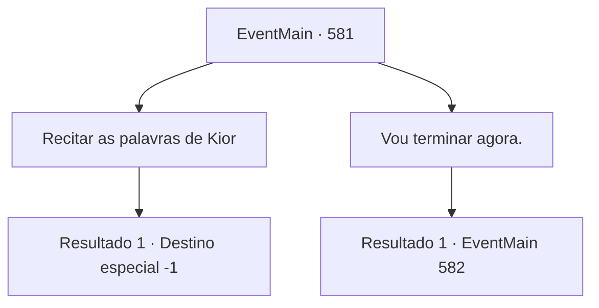

# Eventos principais · 581

[Índice da tabela](index.md) · [Índice geral](../index.md)

ID: `pt:EventMain:581` · Fonte: `EventMain4` · Versão: 1.2.47.

Mapeamento estático dos arquivos; a disponibilidade e a execução dependem do estado da run.

## Texto do evento

*Sem texto no arquivo.*

## Dados de entrada

```json
{
  "id": 581,
  "grade": 1,
  "normalGoal": "",
  "required": ""
}
```

## Mapa das escolhas



## Escolhas e resultados

### Escolha 1

Recitar as palavras de Kior

Requisitos e outros campos da escolha:

```json
{
  "required": ""
}
```

#### Resultado 1.1

Você acena com a cabeça e recita exatamente o que Kior disse. Então Gess se aproxima e se curva diante de você. Ele também está bastante queimado, mas não se importa e diz com um sorriso. 

 "Hehe... Assim mesmo... Farei isso. Tudo é para o Mestre Kior...!"


Continuação registrada: [Destino especial `-1`](../destinos-especiais.md).

```json
{
  "required": "",
  "chance": "1",
  "nextEvent": -1,
  "type": 2,
  "reward": "15_5_8|15_5_14|15_5_16"
}
```

### Escolha 2

Vou terminar agora.

Requisitos e outros campos da escolha:

```json
{
  "required": ""
}
```

#### Resultado 2.1

Você diz que acabaria com sua vingança agora. Então a voz suave de Kior é ouvida. 

 "Do que você está falando? Não foi apenas Publius quem matou sua família. O próprio Teretiano causou a morte injusta de sua família. Portanto, a vingança só acaba quando você se livrar de todos eles. Você não entende isso?"

 Enquanto te persuadindo, ele diz 'conselho' em voz baixa. 

 "E sua vida está sendo mantida pelo meu próprio poder. Se você desistir aqui... Não tenho escolha a não ser recuperar meu poder"

.

Continuação registrada: [Evento 582](0582.md) na mesma tabela.

```json
{
  "required": "",
  "chance": "1",
  "nextEvent": 582,
  "type": 2,
  "reward": ""
}
```

## Referências que chegam a este evento

- [Evento 579 · escolha 1 · resultado 1](0579.md#escolha-1)
- [Evento 580 · escolha 3 · resultado 3](0580.md#escolha-3)
- [Evento 580 · escolha 4 · resultado 1](0580.md#escolha-4)
- [Evento 580 · escolha 4 · resultado 4](0580.md#escolha-4)
