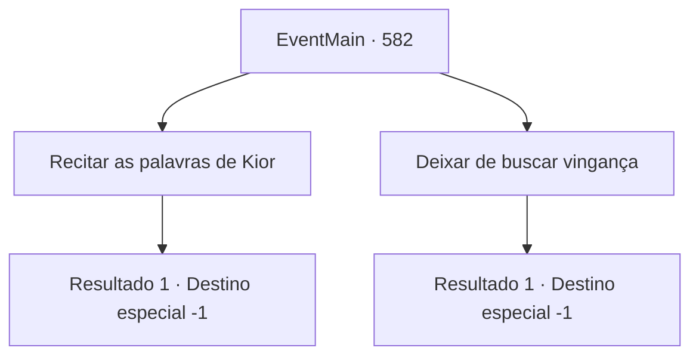

# Eventos principais · 582

[Índice da tabela](index.md) · [Índice geral](../index.md)

ID: `pt:EventMain:582` · Fonte: `EventMain4` · Versão: 1.2.47.

Mapeamento estático dos arquivos; a disponibilidade e a execução dependem do estado da run.

## Texto do evento

*Sem texto no arquivo.*

## Dados de entrada

```json
{
  "id": 582,
  "grade": 1,
  "normalGoal": "",
  "required": ""
}
```

## Mapa das escolhas



## Escolhas e resultados

### Escolha 1

Recitar as palavras de Kior

Requisitos e outros campos da escolha:

```json
{
  "required": ""
}
```

#### Resultado 1.1

No final, você concorda com a 'persuasão' sincera de Kior. 

 "Bem, vamos buscar VINGANÇA. Vamos apagar Tere do mundo."

 Você concorda e repete exatamente o que Kior diz. Então Gess se aproxima e se curva diante de você. Ele também está bastante queimado, mas não se importa e diz com um sorriso. 

 "Hehe... Assim... Eu farei isso. Tudo é para o Mestre Kior...!"


Continuação registrada: [Destino especial `-1`](../destinos-especiais.md).

```json
{
  "required": "",
  "chance": "1",
  "nextEvent": -1,
  "type": 2,
  "reward": "15_5_8|15_5_14|15_5_16"
}
```

### Escolha 2

Deixar de buscar vingança

Requisitos e outros campos da escolha:

```json
{
  "required": ""
}
```

#### Resultado 2.1

Quando você rejeita sua persuasão, a voz de Kior muda. Não é a doce voz que você sempre ouviu, mas sim aquela voz real fria e insidiosa. 

 "Hmm... Se você quer morrer assim, farei isso."

 Ao mesmo tempo em que ele diz isso, a mana de Kior que permanecia em seu corpo desaparece. E a terrível voz de Kior não é mais ouvida. Quando a mana de Kior escapa, você rapidamente fica fraco. Agora você tem a sensação de que o momento da morte está próximo. Então, adoradores de demônios olham para você. 

 "Traição... Você é um traidor!"

 Eles correm em sua direção com os olhos virados para cima. É assim que você acaba com a morte.

Continuação registrada: [Destino especial `-1`](../destinos-especiais.md).

```json
{
  "required": "",
  "chance": "1",
  "nextEvent": -1,
  "type": 2,
  "reward": "15_5_8|15_5_14|15_5_15"
}
```

## Referências que chegam a este evento

- [Evento 581 · escolha 2 · resultado 1](0581.md#escolha-2)
