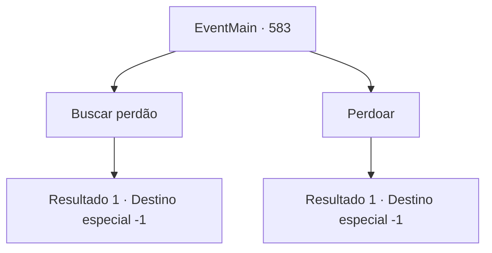

# Eventos principais · 583

[Índice da tabela](index.md) · [Índice geral](../index.md)

ID: `pt:EventMain:583` · Fonte: `EventMain4` · Versão: 1.2.47.

Mapeamento estático dos arquivos; a disponibilidade e a execução dependem do estado da run.

## Texto do evento

*Sem texto no arquivo.*

## Dados de entrada

```json
{
  "id": 583,
  "grade": 1,
  "normalGoal": "",
  "required": ""
}
```

## Mapa das escolhas



## Escolhas e resultados

### Escolha 1

Buscar perdão

Requisitos e outros campos da escolha:

```json
{
  "required": ""
}
```

#### Resultado 1.1

Você pede perdão a Kior, mas ele não mostra piedade. 

 "Agora, morra."

 A mana de Kior, que permanece em seu corpo, desaparece instantaneamente, e a voz de Kior não é mais ouvida. Conforme a mana de Kior escapa, você gradualmente perde o fôlego e não consegue mais respirar. Finalmente, sua visão é submersa na escuridão.

Continuação registrada: [Destino especial `-1`](../destinos-especiais.md).

```json
{
  "required": "",
  "chance": "1",
  "nextEvent": -1,
  "type": 2,
  "reward": "15_5_1|15_5_3|15_5_13"
}
```

### Escolha 2

Perdoar

Requisitos e outros campos da escolha:

```json
{
  "required": ""
}
```

#### Resultado 2.1

Você explica urgentemente a Kior por que não teve escolha a não ser fazer isso. Mas ele dispensa a desculpa com uma voz fria. 

 "Não quero ouvir desculpas esfarrapadas. Vá em frente e morra."

 Com o fim da palavra, o mana de Kior que permanecia em seu corpo desaparece instantaneamente. À medida que o mana de Kior escapa, você gradualmente perde o fôlego e não consegue respirar. Finalmente, sua visão é submersa na escuridão.

Continuação registrada: [Destino especial `-1`](../destinos-especiais.md).

```json
{
  "required": "",
  "chance": "1",
  "nextEvent": -1,
  "type": 2,
  "reward": "15_5_1|15_5_3|15_5_13"
}
```

## Referências que chegam a este evento

- [Evento 580 · escolha 1 · resultado 1](0580.md#escolha-1)
- [Evento 580 · escolha 1 · resultado 2](0580.md#escolha-1)
- [Evento 580 · escolha 1 · resultado 3](0580.md#escolha-1)
- [Evento 580 · escolha 2 · resultado 1](0580.md#escolha-2)
- [Evento 580 · escolha 2 · resultado 2](0580.md#escolha-2)
- [Evento 580 · escolha 3 · resultado 1](0580.md#escolha-3)
- [Evento 580 · escolha 4 · resultado 2](0580.md#escolha-4)
