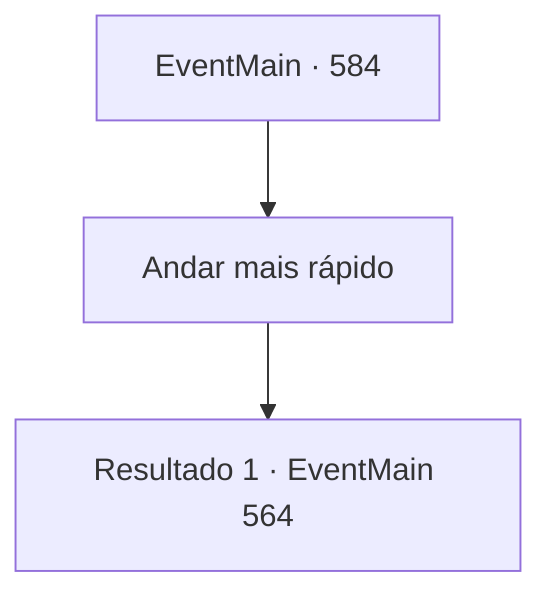

# Eventos principais · 584

[Índice da tabela](index.md) · [Índice geral](../index.md)

ID: `pt:EventMain:584` · Fonte: `EventMain4` · Versão: 1.2.47.

Mapeamento estático dos arquivos; a disponibilidade e a execução dependem do estado da run.

## Texto do evento

Você seguia em direção à vila de Kahida para encontrar os cultistas, quando o som de conversas animadas perto do rio chamou sua atenção. 

 "Você ouviu? Parece que aquele tal de Viyork, o paladino, foi pego conspirando com demônios e fugiu para outro país!"

 Lançando um olhar discreto ao rio, você viu algumas mulheres lavando roupas enquanto fofocavam sem parar. Elas continuavam, dizendo que a Igreja de Tere estava intensificando suas caçadas contra adoradores de demônios, agindo sob ordens diretas do Arcebispo. Enquanto ouvia em silêncio, Kior sussurrou em sua mente com um tom irritado: 

 "Hmph... Ele fugiu, então. Precisamos nos apressar. A Igreja de Tere está se movendo de forma preocupante."


## Dados de entrada

```json
{
  "id": 584,
  "grade": 1,
  "normalGoal": "",
  "required": "1_2_100|13_4_16"
}
```

## Mapa das escolhas



## Escolhas e resultados

### Escolha 1

Andar mais rápido

Requisitos e outros campos da escolha:

```json
{
  "required": ""
}
```

#### Resultado 1.1

Você se apressa para a vila de Kahida, aceitando as palavras de Kior. 

 Dois dias depois,  

 "Capture todos! Não os deixe escapar!"

 Ao chegar na Vila de Kahida, você saca sua arma. Isso porque Danica e os paladinos estão atacando Kahida. Os adoradores de demônios estão caindo impotentes sob o ataque dos paladinos. 

 "Oh! Isso é...!"

 Danica rapidamente reconhece você e ordena que os paladinos ataquem. Você dá força às suas mãos ao ver os paladinos correndo.

Continuação registrada: [Evento 564](0564.md) na mesma tabela.

```json
{
  "required": "",
  "chance": "1",
  "nextEvent": 564,
  "type": 2,
  "reward": "6_3_50|15_5_30",
  "place": 4
}
```

## Referências que chegam a este evento

Nenhum `nextEvent` positivo da mesma tabela aponta para este nó. Isso não prova que seja inacessível: sorteio e estado de história podem selecioná-lo.

