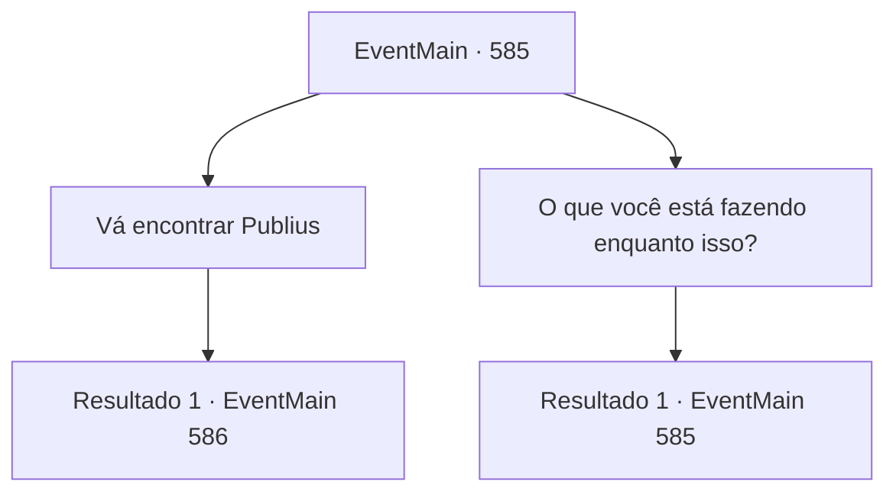

# Eventos principais · 585

[Índice da tabela](index.md) · [Índice geral](../index.md)

ID: `pt:EventMain:585` · Fonte: `EventMain4` · Versão: 1.2.47.

Mapeamento estático dos arquivos; a disponibilidade e a execução dependem do estado da run.

## Texto do evento

Você encontrou Viyork novamente na mansão dele. Ele estava relaxado, observando um quadro pendurado na sala de estar. Você também olhou para a pintura por um momento. Nela, havia um navio navegando por um mar tempestuoso, com o capitão caindo na água enquanto os marinheiros erguiam suas espadas e comemoravam.  De repente, Viyork se virou para você e disse: 

 "Publius desapareceu. Como você sabe, ele perdeu todos os seus subordinados."

  Enquanto falava, Viyork tirou um mapa do bolso. Ele apontou para um local marcado com um X e, em um tom baixo, contou o que queria de você: 

 "Descobri onde Publio está escondido. É exatamente aqui. Vá e termine a sua vingança."


## Dados de entrada

```json
{
  "id": 585,
  "grade": 1,
  "normalGoal": "",
  "required": "1_2_100|13_4_11"
}
```

## Mapa das escolhas



## Escolhas e resultados

### Escolha 1

Vá encontrar Publius

Requisitos e outros campos da escolha:

```json
{
  "required": ""
}
```

#### Resultado 1.1

Você vai para onde Publius desapareceu com um mapa entregue por Viyork. Fica no final do 'Planalto Aether', bastante longe. |drawing_hidePublius| Chegando ao Planalto Ishtar em alguns dias, você olha para o penhasco onde se supõe que Publius esteja escondido. Há um antigo mosteiro no penhasco. E os degraus de pedra que levam até lá estão perigosamente presos ao penhasco.

Continuação registrada: [Evento 586](0586.md) na mesma tabela.

```json
{
  "required": "",
  "chance": "1",
  "nextEvent": 586,
  "type": 2,
  "reward": ""
}
```

### Escolha 2

O que você está fazendo enquanto isso?

Requisitos e outros campos da escolha:

```json
{
  "required": "5_372_0"
}
```

#### Resultado 2.1

Você pergunta a Viyork o que ele fará enquanto isso. Ele responde à pergunta com um sorriso irônico. 

 "Não é que eu não acredite em você, mas talvez ele possa fugir? Estou pensando em preparar uma contramedida para ele. Como é o último, temos que ter cuidado."

 Ele te dá um tapinha no ombro, dizendo para você se sentir à vontade para ir.

Continuação registrada: [Evento 585](0585.md) na mesma tabela.

```json
{
  "required": "",
  "chance": "1",
  "nextEvent": 585,
  "type": 2,
  "reward": "5_372_1"
}
```

## Referências que chegam a este evento

- [Evento 585 · escolha 2 · resultado 1](0585.md#escolha-2)
