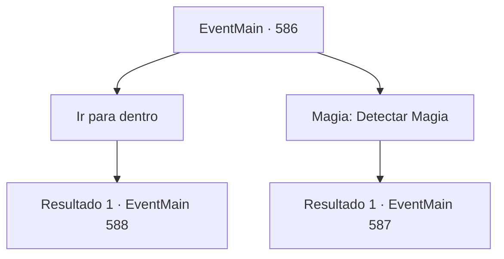

# Eventos principais · 586

[Índice da tabela](index.md) · [Índice geral](../index.md)

ID: `pt:EventMain:586` · Fonte: `EventMain4` · Versão: 1.2.47.

Mapeamento estático dos arquivos; a disponibilidade e a execução dependem do estado da run.

## Texto do evento

*Sem texto no arquivo.*

## Dados de entrada

```json
{
  "id": 586,
  "grade": 1,
  "normalGoal": "",
  "required": ""
}
```

## Mapa das escolhas



## Escolhas e resultados

### Escolha 1

Ir para dentro

Requisitos e outros campos da escolha:

```json
{
  "required": ""
}
```

#### Resultado 1.1

Você chuta a porta do mosteiro. De repente, seu corpo fica lento e você cambaleia sem perceber. 

 "Pegue! É o demônio!"

 Só há paladinos esperando por você, não Publius. Eles te atacam com pressa enquanto você vacila. Você força seu corpo pesado a lutar contra o ataque deles.

Continuação registrada: [Evento 588](0588.md) na mesma tabela.

```json
{
  "required": "",
  "chance": "1",
  "nextEvent": 588,
  "type": 2,
  "reward": "6_3_50",
  "place": 10
}
```

### Escolha 2

Magia: Detectar Magia

Requisitos e outros campos da escolha:

```json
{
  "required": "20_0_1|1_1_2"
}
```

#### Resultado 2.1

Você detecta a magia dentro do mosteiro antes de realizar o Detectar Magia. Há uma concentração intensa de mana e você percebe que é uma espécie de barreira. Então, o Kior sussurra em sua mente. 

 "Hmm... um arcebispo sabe como fazer algo assim... Se você for lá, meu poder enfraquecerá, então tenha cuidado."


Continuação registrada: [Evento 587](0587.md) na mesma tabela.

```json
{
  "required": "",
  "chance": "1",
  "nextEvent": 587,
  "type": 2,
  "reward": ""
}
```

## Referências que chegam a este evento

- [Evento 585 · escolha 1 · resultado 1](0585.md#escolha-1)
