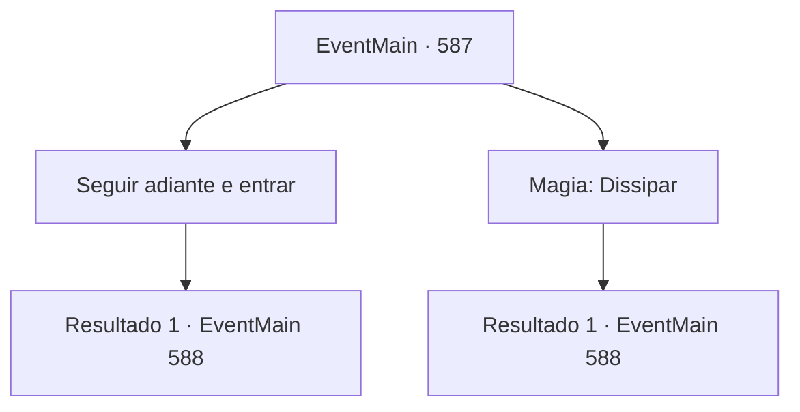

# Eventos principais · 587

[Índice da tabela](index.md) · [Índice geral](../index.md)

ID: `pt:EventMain:587` · Fonte: `EventMain4` · Versão: 1.2.47.

Mapeamento estático dos arquivos; a disponibilidade e a execução dependem do estado da run.

## Texto do evento

*Sem texto no arquivo.*

## Dados de entrada

```json
{
  "id": 587,
  "grade": 1,
  "normalGoal": "",
  "required": ""
}
```

## Mapa das escolhas



## Escolhas e resultados

### Escolha 1

Seguir adiante e entrar

Requisitos e outros campos da escolha:

```json
{
  "required": ""
}
```

#### Resultado 1.1

Você entra no mosteiro apesar do aviso de Kior. Então, de repente, seu corpo fica lento e você cambaleia sem perceber. 

 "Pegue! É o demônio!"

 Só há paladinos esperando por você, não Publius. Eles te atacam com pressa enquanto você vacila. Você força seu corpo pesado a lutar contra o ataque deles.

Continuação registrada: [Evento 588](0588.md) na mesma tabela.

```json
{
  "required": "",
  "chance": "1",
  "nextEvent": 588,
  "type": 2,
  "reward": "6_3_50",
  "place": 10
}
```

### Escolha 2

Magia: Dissipar

Requisitos e outros campos da escolha:

```json
{
  "required": "20_0_2|1_1_2"
}
```

#### Resultado 2.1

Você lança um Dispel magic e desmonta a barreira montada no mosteiro. No entanto, a barreira é restaurada instantaneamente e o resultado é o mesmo, não importa quantas vezes você tente. Você entra, percebendo que não tem escolha a não ser ser determinado. Então, como Kior disse, você sente que sua força está sendo drenada. 

 "Pegue! É o demônio!"

 Só há paladinos esperando por você, não Publius. Eles te atacam com pressa enquanto você vacila. Você força seu corpo pesado a lutar contra o ataque deles.

Continuação registrada: [Evento 588](0588.md) na mesma tabela.

```json
{
  "required": "",
  "chance": "1",
  "nextEvent": 588,
  "type": 2,
  "reward": "0_1_-1|6_3_50",
  "place": 10
}
```

## Referências que chegam a este evento

- [Evento 586 · escolha 2 · resultado 1](0586.md#escolha-2)
