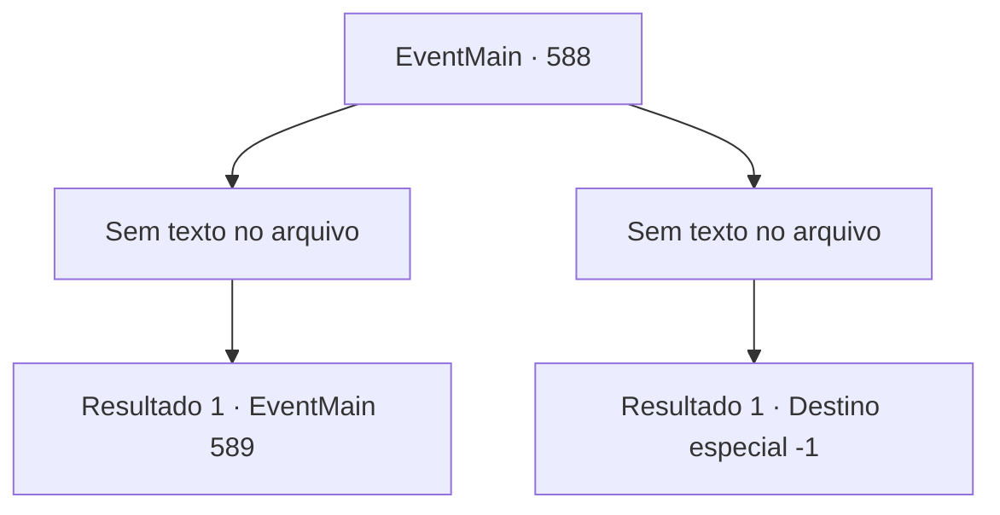

# Eventos principais · 588

[Índice da tabela](index.md) · [Índice geral](../index.md)

ID: `pt:EventMain:588` · Fonte: `EventMain4` · Versão: 1.2.47.

Mapeamento estático dos arquivos; a disponibilidade e a execução dependem do estado da run.

## Texto do evento

*Sem texto no arquivo.*

## Dados de entrada

```json
{
  "id": 588,
  "grade": 1,
  "normalGoal": "",
  "required": ""
}
```

## Mapa das escolhas



## Escolhas e resultados

### Escolha 1

*Sem texto no arquivo; o papel dessa opção depende da interface do jogo.*

Requisitos e outros campos da escolha:

```json
{
  "required": ""
}
```

#### Resultado 1.1

Você, que derrubou todos os paladinos, pegue as almas e vasculhe o mosteiro.  Então, você encontra uma porta escondida sob o tapete que leva ao porão.  Você abre a porta no chão e cuidadosamente entra.  Enquanto desce lentamente as escadas, você vê um passageiro subterrâneo escuro dividido em dois ramos.

Continuação registrada: [Evento 589](0589.md) na mesma tabela.

```json
{
  "required": "",
  "chance": "1",
  "nextEvent": 589,
  "type": 2,
  "reward": ""
}
```

### Escolha 2

*Sem texto no arquivo; o papel dessa opção depende da interface do jogo.*

Requisitos e outros campos da escolha:

```json
{
  "required": ""
}
```

#### Resultado 2.1

Seu corpo, pesado pela magia, fez com que você fosse incapaz de exercer toda a sua força. Eventualmente, você se ajoelha diante do ataque impiedoso dos paladinos, e o choque surdo abala sua cabeça. Você perde a consciência e cai no chão frio.

Continuação registrada: [Destino especial `-1`](../destinos-especiais.md).

```json
{
  "required": "",
  "chance": "1",
  "nextEvent": -1,
  "type": 2,
  "reward": "0_0_-1|0_1_-1|15_5_2|15_5_13"
}
```

## Referências que chegam a este evento

- [Evento 586 · escolha 1 · resultado 1](0586.md#escolha-1)
- [Evento 587 · escolha 1 · resultado 1](0587.md#escolha-1)
- [Evento 587 · escolha 2 · resultado 1](0587.md#escolha-2)
