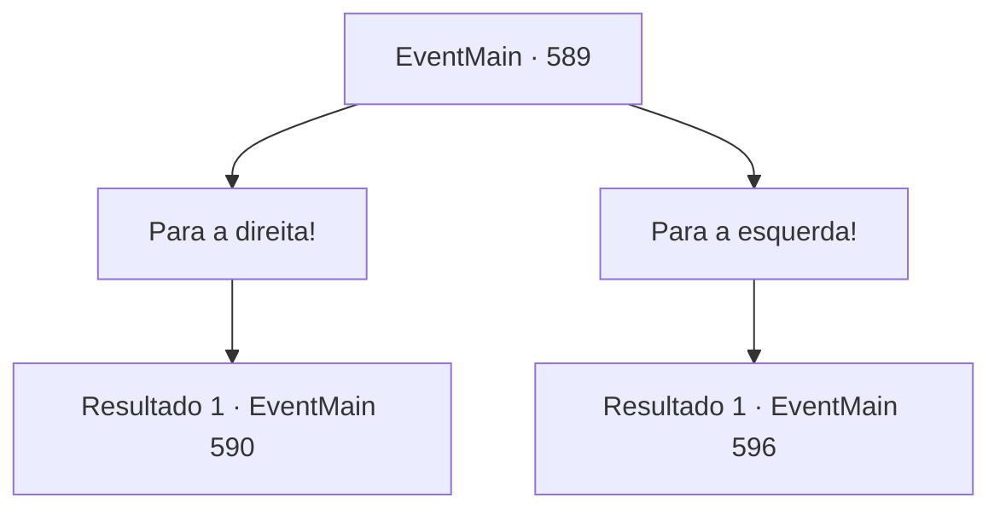

# Eventos principais · 589

[Índice da tabela](index.md) · [Índice geral](../index.md)

ID: `pt:EventMain:589` · Fonte: `EventMain4` · Versão: 1.2.47.

Mapeamento estático dos arquivos; a disponibilidade e a execução dependem do estado da run.

## Texto do evento

*Sem texto no arquivo.*

## Dados de entrada

```json
{
  "id": 589,
  "grade": 1,
  "normalGoal": "",
  "required": ""
}
```

## Mapa das escolhas



## Escolhas e resultados

### Escolha 1

Para a direita!

Requisitos e outros campos da escolha:

```json
{
  "required": ""
}
```

#### Resultado 1.1

Você caminha pelo caminho certo. O corredor subterrâneo tem estátuas de pedra em forma de monstros, às vezes vazias sob os pés, ou armaduras empoeiradas como ornamentos. E no momento em que você está prestes a passar pela armadura completa em exposição. De repente, ela se move e começa a balançar a espada em sua direção.

Continuação registrada: [Evento 590](0590.md) na mesma tabela.

```json
{
  "required": "",
  "chance": "1",
  "nextEvent": 590,
  "type": 2,
  "reward": "6_0_150",
  "place": 6
}
```

### Escolha 2

Para a esquerda!

Requisitos e outros campos da escolha:

```json
{
  "required": ""
}
```

#### Resultado 2.1

Você anda à esquerda. O túnel subterrâneo está escuro, então você não consegue ver bem à sua frente, mas ao atravessar a parede, você consegue ver em qual direção está caminhando. Depois de caminhar por muito tempo, você de repente para. Isso acontece porque um beco sem saída aparece, sem nenhuma maneira de prosseguir. Justo quando você está prestes a voltar, de repente você ouve um barulho alto.

 <link=shake>'Koo-goo-goo-goo-goo-goo-goo-goo-gung'</link>

 Com um rugido, as barras descem e te prendem instantaneamente. Logo depois disso, um som grotesco de metais. E o teto espinhoso começa a descer lentamente.

Continuação registrada: [Evento 596](0596.md) na mesma tabela.

```json
{
  "required": "",
  "chance": "1",
  "nextEvent": 596,
  "type": 2,
  "reward": ""
}
```

## Referências que chegam a este evento

- [Evento 588 · escolha 1 · resultado 1](0588.md#escolha-1)
