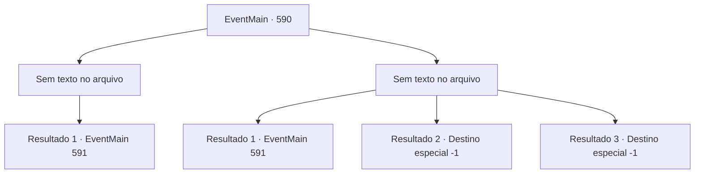

# Eventos principais · 590

[Índice da tabela](index.md) · [Índice geral](../index.md)

ID: `pt:EventMain:590` · Fonte: `EventMain4` · Versão: 1.2.47.

Mapeamento estático dos arquivos; a disponibilidade e a execução dependem do estado da run.

## Texto do evento

*Sem texto no arquivo.*

## Dados de entrada

```json
{
  "id": 590,
  "grade": 1,
  "normalGoal": "",
  "required": ""
}
```

## Mapa das escolhas



## Escolhas e resultados

### Escolha 1

*Sem texto no arquivo; o papel dessa opção depende da interface do jogo.*

Requisitos e outros campos da escolha:

```json
{
  "required": ""
}
```

#### Resultado 1.1

Você quebra a armadura em movimento e segue em frente.

 Depois de um tempo, você chega ao final da estrada à direita e para de caminhar e olha ao redor. É uma sala vazia, sem móveis. Um corredor sobrenatural está aberto na parede direita. O corredor parece ter sido originalmente coberto, e há vestígios de algo sendo arrastado no chão.

Continuação registrada: [Evento 591](0591.md) na mesma tabela.

```json
{
  "required": "",
  "chance": "1",
  "nextEvent": 591,
  "type": 2,
  "reward": ""
}
```

### Escolha 2

*Sem texto no arquivo; o papel dessa opção depende da interface do jogo.*

Requisitos e outros campos da escolha:

```json
{
  "required": ""
}
```

#### Resultado 2.1

A armadura em movimento balança a espada como um cavaleiro fiel e nunca para o ataque. Tudo o que você pode fazer contra um inimigo assim é fugir.

 Depois de um tempo, você para de caminhar e olha ao redor depois de fugir. O lugar em que você chegou é uma sala vazia sem móveis. Um corredor não natural está aberto na parede direita. O corredor estava originalmente coberto, mas há vestígios de algo sendo arrastado no chão.

Continuação registrada: [Evento 591](0591.md) na mesma tabela.

```json
{
  "required": "1_0_2|1_1_2",
  "chance": "1",
  "nextEvent": 591,
  "type": 2,
  "reward": "0_0_-1|0_1_-1"
}
```

#### Resultado 2.2

A armadura em movimento balança a espada como um cavaleiro fiel e nunca para o ataque. Eventualmente, você perde a consciência com o ataque de uma armadura em movimento.

Continuação registrada: [Destino especial `-1`](../destinos-especiais.md).

```json
{
  "required": "2_0_2",
  "chance": "1",
  "nextEvent": -1,
  "type": 2,
  "reward": "0_0_-1|0_1_-1|15_5_2|15_5_13"
}
```

#### Resultado 2.3

A armadura em movimento balança a espada como um cavaleiro fiel e nunca para o ataque. Eventualmente, você perde a consciência com o ataque de uma armadura em movimento.

Continuação registrada: [Destino especial `-1`](../destinos-especiais.md).

```json
{
  "required": "2_1_2",
  "chance": "1",
  "nextEvent": -1,
  "type": 2,
  "reward": "0_0_-1|0_1_-1|15_5_2|15_5_13"
}
```

## Referências que chegam a este evento

- [Evento 589 · escolha 1 · resultado 1](0589.md#escolha-1)
- [Evento 596 · escolha 1 · resultado 1](0596.md#escolha-1)
- [Evento 596 · escolha 1 · resultado 2](0596.md#escolha-1)
- [Evento 596 · escolha 2 · resultado 1](0596.md#escolha-2)
- [Evento 596 · escolha 2 · resultado 2](0596.md#escolha-2)
- [Evento 596 · escolha 3 · resultado 1](0596.md#escolha-3)
