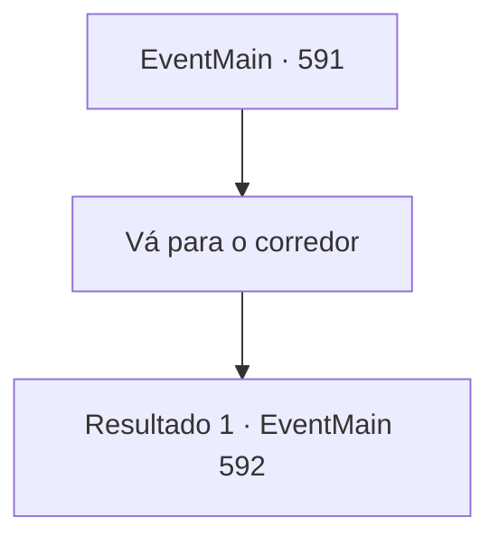

# Eventos principais · 591

[Índice da tabela](index.md) · [Índice geral](../index.md)

ID: `pt:EventMain:591` · Fonte: `EventMain4` · Versão: 1.2.47.

Mapeamento estático dos arquivos; a disponibilidade e a execução dependem do estado da run.

## Texto do evento

*Sem texto no arquivo.*

## Dados de entrada

```json
{
  "id": 591,
  "grade": 1,
  "normalGoal": "",
  "required": ""
}
```

## Mapa das escolhas



## Escolhas e resultados

### Escolha 1

Vá para o corredor

Requisitos e outros campos da escolha:

```json
{
  "required": ""
}
```

#### Resultado 1.1

Você caminha cuidadosamente pelo corredor suspeito. É difícil andar lá porque é apertado, mas felizmente não há armadilhas ou monstros. Até onde você foi? De repente, você franze a testa com a luz brilhante vista ao longe. O fim do corredor está fora do túnel subterrâneo. 

 "Você chegou até aqui. Adorador de demônios {1}. Sua maldade acabou agora."

 Ao sair do corredor, você ouve a voz de Viyork. E lá, junto com os Viyorks e os paladinos, espera por você um velho homem vestido com um traje vermelho sacerdotal ricamente bordado. |drawing_publius| Você percebe intuitivamente que o velho homem é o Arcebispo de Teretian 'Publius'.

Continuação registrada: [Evento 592](0592.md) na mesma tabela.

```json
{
  "required": "",
  "chance": "1",
  "nextEvent": 592,
  "type": 2,
  "reward": ""
}
```

## Referências que chegam a este evento

- [Evento 590 · escolha 1 · resultado 1](0590.md#escolha-1)
- [Evento 590 · escolha 2 · resultado 1](0590.md#escolha-2)
