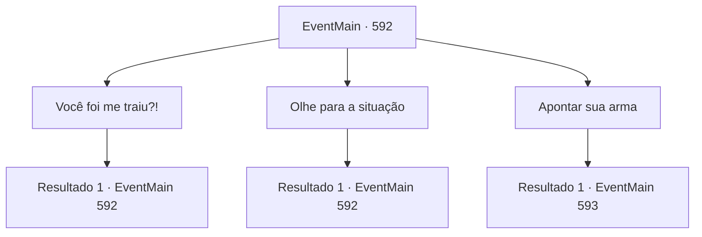

# Eventos principais · 592

[Índice da tabela](index.md) · [Índice geral](../index.md)

ID: `pt:EventMain:592` · Fonte: `EventMain4` · Versão: 1.2.47.

Mapeamento estático dos arquivos; a disponibilidade e a execução dependem do estado da run.

## Texto do evento

*Sem texto no arquivo.*

## Dados de entrada

```json
{
  "id": 592,
  "grade": 1,
  "normalGoal": "",
  "required": ""
}
```

## Mapa das escolhas



## Escolhas e resultados

### Escolha 1

Você foi me traiu?!

Requisitos e outros campos da escolha:

```json
{
  "required": "5_385_0"
}
```

#### Resultado 1.1

Você olha para Viyork, perguntando se ele te traiu. Viyork responde audaciosamente, encarando seus olhos daquela maneira. 

 "Traição? Você achou que era cooperação? Eu apenas... Eu apenas tive a chance de provar minha fé ao Arcebispo novamente. Minha fé em Deus Tere."


Continuação registrada: [Evento 592](0592.md) na mesma tabela.

```json
{
  "required": "",
  "chance": "1",
  "nextEvent": 592,
  "type": 2,
  "reward": "5_385_1"
}
```

### Escolha 2

Olhe para a situação

Requisitos e outros campos da escolha:

```json
{
  "required": "5_386_0"
}
```

#### Resultado 2.1

Você observa a situação olhando de lado para os paladinos. Eles te cercam para que você não escape, e você está prestes a atacar sempre que ordenado. Viyork tem um sorriso malicioso ao lado de Publius. No entanto, a atmosfera entre os dois parece fria, como se não confiassem um no outro.

Continuação registrada: [Evento 592](0592.md) na mesma tabela.

```json
{
  "required": "",
  "chance": "1",
  "nextEvent": 592,
  "type": 2,
  "reward": "5_386_1"
}
```

### Escolha 3

Apontar sua arma

Requisitos e outros campos da escolha:

```json
{
  "required": "5_386_1|5_385_1"
}
```

#### Resultado 3.1


 "Oh meu... Traído novamente? Que destino estranho {1}. No entanto, isso pode ser uma boa oportunidade."

 Kior diz que esta é uma crise desesperadora, mas, ao mesmo tempo, uma oportunidade de ouro para se vingar. 

 "Arcebispo. Deixe-me liderar. Eu vou matar aquele demônio e provar minha fé em Tere."

 A pedido de Viyork, Publius acena com a cabeça e lança o feitiço. Um flash de luz emerge de sua mão e envolve Viyork e os paladinos. Logo, Viyork e os paladinos, cercados por uma luz brilhante, correm em sua direção.

Continuação registrada: [Evento 593](0593.md) na mesma tabela.

```json
{
  "required": "",
  "chance": "1",
  "nextEvent": 593,
  "type": 2,
  "reward": "6_3_147",
  "place": 0
}
```

## Referências que chegam a este evento

- [Evento 591 · escolha 1 · resultado 1](0591.md#escolha-1)
- [Evento 592 · escolha 1 · resultado 1](0592.md#escolha-1)
- [Evento 592 · escolha 2 · resultado 1](0592.md#escolha-2)
