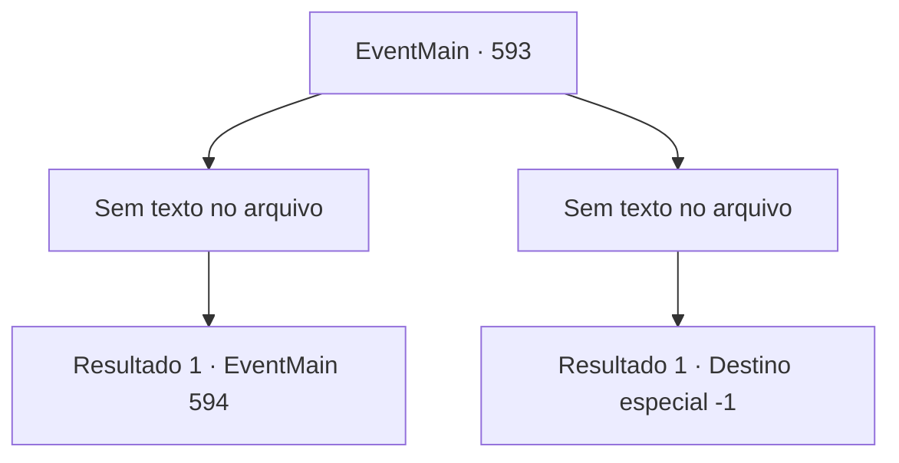

# Eventos principais · 593

[Índice da tabela](index.md) · [Índice geral](../index.md)

ID: `pt:EventMain:593` · Fonte: `EventMain4` · Versão: 1.2.47.

Mapeamento estático dos arquivos; a disponibilidade e a execução dependem do estado da run.

## Texto do evento

*Sem texto no arquivo.*

## Dados de entrada

```json
{
  "id": 593,
  "grade": 1,
  "normalGoal": "",
  "required": ""
}
```

## Mapa das escolhas



## Escolhas e resultados

### Escolha 1

*Sem texto no arquivo; o papel dessa opção depende da interface do jogo.*

Requisitos e outros campos da escolha:

```json
{
  "required": ""
}
```

#### Resultado 1.1

Você pega a alma dos paladinos moribundos, sangrando, e se aproxima lentamente de Viyork. Viyork, coberto de feridas, já perdeu sua vontade de lutar. 

 "Oh, meu Deus...! Você demônio! Vá embora..! Vá embora!"

 E no momento em que você tenta tirar seu fôlego. A voz repentina de Publius te impede. A voz é poderosa o suficiente para te forçar. <b><link=shake>

 "Ajoelhe-se!"

</link></b> O que Publius diz é um feitiço chamado 'palavra de poder' que força a ação de alguém. Suas pernas estão tentando se ajoelhar independentemente da sua vontade.

Continuação registrada: [Evento 594](0594.md) na mesma tabela.

```json
{
  "required": "",
  "chance": "1",
  "nextEvent": 594,
  "type": 2,
  "reward": ""
}
```

### Escolha 2

*Sem texto no arquivo; o papel dessa opção depende da interface do jogo.*

Requisitos e outros campos da escolha:

```json
{
  "required": ""
}
```

#### Resultado 2.1

Você está atordoado com o ataque contínuo dos paladinos. E naquele exato momento, Viyork salta em sua direção e empunha sua espada. Você não consegue evitar esse ataque afiado. Você desaba com uma explosão de sangue, e enquanto olha para isso, Viyork levanta o punho e grita. 

 "Este Viyork capturou o adorador do demônio maligno!"

 Você olha para o rosto de Viyork através de uma visão embaçada. Ele levanta o punho, olha para você e move os lábios para que apenas você possa ver. Seus lábios dizem: 'Traição, você fez isso primeiro'.

Continuação registrada: [Destino especial `-1`](../destinos-especiais.md).

```json
{
  "required": "",
  "chance": "1",
  "nextEvent": -1,
  "type": 2,
  "reward": "0_0_-1|0_1_-1|15_5_2|15_5_13|15_5_23"
}
```

## Referências que chegam a este evento

- [Evento 592 · escolha 3 · resultado 1](0592.md#escolha-3)
