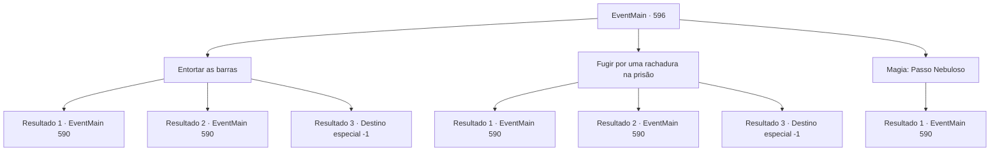

# Eventos principais · 596

[Índice da tabela](index.md) · [Índice geral](../index.md)

ID: `pt:EventMain:596` · Fonte: `EventMain4` · Versão: 1.2.47.

Mapeamento estático dos arquivos; a disponibilidade e a execução dependem do estado da run.

## Texto do evento

*Sem texto no arquivo.*

## Dados de entrada

```json
{
  "id": 596,
  "grade": 1,
  "normalGoal": "",
  "required": ""
}
```

## Mapa das escolhas



## Escolhas e resultados

### Escolha 1

Entortar as barras

Requisitos e outros campos da escolha:

```json
{
  "required": ""
}
```

#### Resultado 1.1

Você rapidamente dobra as barras e escapa de lá. E volta pelo caminho que veio, e segue para a direita.

 Do lado direito da estrada estão estátuas de pedra em forma de monstros, às vezes vazias embaixo, ou armaduras empoeiradas colocadas como ornamentos. E é no momento em que você está prestes a passar pela armadura completa em exposição. De repente, ela se move e começa a balançar a espada em sua direção.

Continuação registrada: [Evento 590](0590.md) na mesma tabela.

```json
{
  "required": "",
  "chance": "1|0_5_1",
  "nextEvent": 590,
  "type": 0,
  "reward": "6_0_150",
  "place": 6
}
```

#### Resultado 1.2

Tentas escapar, dobrando assim as barras. No entanto, as barras não dobram facilmente. Então corres o mais rápido que podes e bates nas barras. A barra quebra com um estrondo, mas o teu ombro também sente uma dor aguda. De qualquer forma, depois de salvares a tua vida, voltas pelo caminho que vieste e segues para a direita.

 Do lado direito da estrada estão estátuas de pedra em forma de monstros, às vezes vazias por baixo, ou armaduras empoeiradas colocadas como ornamentos. E é nesse momento que estás prestes a passar pela armadura completa em exposição. De repente, ela mexe-se e começa a balançar a espada em tua direção.

Continuação registrada: [Evento 590](0590.md) na mesma tabela.

```json
{
  "required": "",
  "chance": "16",
  "nextEvent": 590,
  "type": 1,
  "reward": "0_0_-1|6_0_150",
  "place": 6
}
```

#### Resultado 1.3

Você tenta dobrar as barras, mas é uma tentativa difícil. Eventualmente, você não consegue evitar o teto desabando e é sobrecarregado pelo peso pesado. 

 "Ah não... Estamos quase lá... Que pena..."

 A voz de Kior batendo na língua é ouvida de forma confusa.

Continuação registrada: [Destino especial `-1`](../destinos-especiais.md).

```json
{
  "required": "",
  "chance": "16",
  "nextEvent": -1,
  "type": 1,
  "reward": "0_0_-1|15_5_2|15_5_13"
}
```

### Escolha 2

Fugir por uma rachadura na prisão

Requisitos e outros campos da escolha:

```json
{
  "required": ""
}
```

#### Resultado 2.1

Você se move flexivelmente através das rachaduras das barras e escapa de lá. E volta pelo caminho que veio e segue para a direita.

 Do lado direito da estrada estão estátuas de pedra em forma de monstros, às vezes vazias embaixo, ou armaduras empoeiradas colocadas como ornamentos. E é no momento em que você está prestes a passar pela armadura completa em exposição. De repente, ela se move e começa a balançar a espada em sua direção.

Continuação registrada: [Evento 590](0590.md) na mesma tabela.

```json
{
  "required": "",
  "chance": "1|0_6_1",
  "nextEvent": 590,
  "type": 0,
  "reward": "6_0_150",
  "place": 6
}
```

#### Resultado 2.2

Você se move flexivelmente através das rachaduras das barras e escapa de lá. Enquanto escapava, houve uma situação em que o ombro ficou preso nas barras, mas foi possível torcer e puxar forçadamente para fora. E volte pelo caminho que veio e siga para a direita.

 Do lado direito da estrada, há estátuas de pedra em forma de monstros, às vezes vazias embaixo, ou armaduras empoeiradas colocadas como ornamentos. E é o momento em que você está prestes a passar pela armadura completa em exibição. De repente, ela se move e começa a balançar a espada em sua direção.

Continuação registrada: [Evento 590](0590.md) na mesma tabela.

```json
{
  "required": "",
  "chance": "16",
  "nextEvent": 590,
  "type": 1,
  "reward": "0_0_-1|6_0_150",
  "place": 6
}
```

#### Resultado 2.3

Tentas escapar da abertura entre as barras, mas a abertura nas barras estreitas não permite. Eventualmente, não consegues evitar o teto que desce e és sobrecarregado pelo peso. 

 "Ah não... Estamos quase lá... Que pena..."

 A voz de Kior, batendo a língua, é ouvida de forma confusa.

Continuação registrada: [Destino especial `-1`](../destinos-especiais.md).

```json
{
  "required": "",
  "chance": "16",
  "nextEvent": -1,
  "type": 1,
  "reward": "0_0_-1|15_5_2|15_5_13"
}
```

### Escolha 3

Magia: Passo Nebuloso

Requisitos e outros campos da escolha:

```json
{
  "required": "20_0_1|1_1_2"
}
```

#### Resultado 3.1

Você rapidamente contorce seu corpo como gás e desliza através das barras da janela. E volta pelo caminho que veio e segue para a direita.

 Do lado direito da estrada estão estátuas de pedra em forma de monstros, às vezes vazias embaixo, ou armaduras empoeiradas colocadas como ornamentos. E é no momento em que você está prestes a passar pela armadura completa em exposição. De repente, ela se move e começa a balançar a espada em sua direção.

Continuação registrada: [Evento 590](0590.md) na mesma tabela.

```json
{
  "required": "",
  "chance": "1",
  "nextEvent": 590,
  "type": 2,
  "reward": "6_0_150|0_1_-1",
  "place": 6
}
```

## Referências que chegam a este evento

- [Evento 589 · escolha 2 · resultado 1](0589.md#escolha-2)
