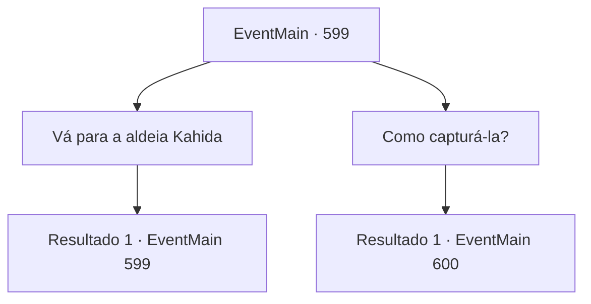

# Eventos principais · 599

[Índice da tabela](index.md) · [Índice geral](../index.md)

ID: `pt:EventMain:599` · Fonte: `EventMain4` · Versão: 1.2.47.

Mapeamento estático dos arquivos; a disponibilidade e a execução dependem do estado da run.

## Texto do evento

Você estava descansando em uma taverna da cidade. Enquanto tomava um gole de cerveja para recuperar o fôlego, algo no chão chamou sua atenção: uma centopeia de cor marrom-escura. Ela se contorcia de maneira incomum, como se estivesse tentando transmitir algo a você. Seus olhos fixaram-se nos movimentos dela até que, subitamente, você percebeu o que era: A criatura estava escrevendo. 
 'Venha ao esconderijo.'

## Dados de entrada

```json
{
  "id": 599,
  "grade": 1,
  "normalGoal": "",
  "required": "1_2_25|13_4_3"
}
```

## Mapa das escolhas



## Escolhas e resultados

### Escolha 1

Vá para a aldeia Kahida

Requisitos e outros campos da escolha:

```json
{
  "required": "5_387_0"
}
```

#### Resultado 1.1

Você se apressa para a Vila de Kahida. Felizmente, está próxima, então leva menos de meio dia para chegar à vila. Quando você chega à vila, adoradores escondidos em abrigos subterrâneos aparecem. Eles se curvam para você mais uma vez, e Gess diz. 

 "Nós conseguimos reunir as informações que o contratante queria. Para destruir Teretian, precisamos atrair Danica."

 Ele diz que Danica é o 'olho de Publius' que coleta informações através do trabalho missionário fora da igreja. Além disso, Gess diz que, como Publius só obtém informações externas através dela, você deve capturá-la para se vingar dele.

Continuação registrada: [Evento 599](0599.md) na mesma tabela.

```json
{
  "required": "",
  "chance": "1",
  "nextEvent": 599,
  "type": 2,
  "reward": "5_387_1"
}
```

### Escolha 2

Como capturá-la?

Requisitos e outros campos da escolha:

```json
{
  "required": "5_387_1"
}
```

#### Resultado 2.1

Quando você pergunta como capturar Danica, Gess sugere uma maneira. É oferecer publicamente uma cerimônia a Kior para atrair a atenção de Teretian. 

 "Esta cidade está sendo vigiada por Teretian. Estamos aproveitando isso. Se você ver algum sinal suspeito, eles definitivamente virão."

 Gess pede que você consiga o sacrifício necessário para a cerimônia, pois ele irá prepará-lo. Há um pequeno rancho no 'morro de Henobi' nas proximidades, onde ele pede três vacas e três ovelhas cada. 

 Você leva três adoradores para o rancho. Você caminha por cerca de uma hora. Henobi é um rancho onde são criados gado, cabras e ovelhas. O gado está pastando tranquilamente na cerca, e o fazendeiro está dormindo em uma cadeira de balanço.

Continuação registrada: [Evento 600](0600.md) na mesma tabela.

```json
{
  "required": "",
  "chance": "1",
  "nextEvent": 600,
  "type": 2,
  "reward": "5_387_2"
}
```

## Referências que chegam a este evento

- [Evento 599 · escolha 1 · resultado 1](0599.md#escolha-1)
