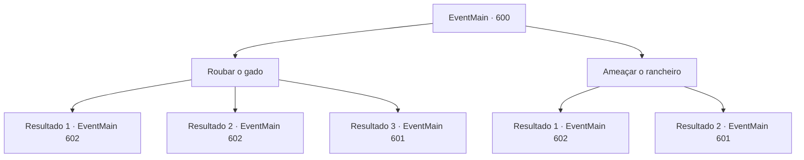

# Eventos principais · 600

[Índice da tabela](index.md) · [Índice geral](../index.md)

ID: `pt:EventMain:600` · Fonte: `EventMain4` · Versão: 1.2.47.

Mapeamento estático dos arquivos; a disponibilidade e a execução dependem do estado da run.

## Texto do evento

*Sem texto no arquivo.*

## Dados de entrada

```json
{
  "id": 600,
  "grade": 1,
  "normalGoal": "",
  "required": ""
}
```

## Mapa das escolhas



## Escolhas e resultados

### Escolha 1

Roubar o gado

Requisitos e outros campos da escolha:

```json
{
  "required": ""
}
```

#### Resultado 1.1

Você se aproxima cuidadosamente da cerca, evitando os olhos do fazendeiro. Então você e os adoradores matam três vacas e três ovelhas cada um e secretamente levam suas cabeças e vão para Kahida. Quando você traz a oferta, Gess imediatamente começa a cerimônia. Um sacrifício é colocado em um altar construído no centro da Vila de Kahida, e fumaça negra é enviada ao céu com fogo. 

 "Oh! um grande ser que se torna o mestre da escuridão! Por favor, aceite nosso sacrifício!"

 Outros adoradores gritam juntos ao grito de Gess. Kior lambe os lábios, dizendo que essas oferendas não são muito eficientes.

Continuação registrada: [Evento 602](0602.md) na mesma tabela.

```json
{
  "required": "",
  "chance": "1|0_6_1",
  "nextEvent": 602,
  "type": 0,
  "reward": "0_2_1|5_388_1"
}
```

#### Resultado 1.2

Você se aproxima cuidadosamente da cerca, evitando os olhos do fazendeiro. Então você e os adoradores matam três vacas e três ovelhas cada um e secretamente levam suas cabeças e vão para Kahida. Quando você traz a oferta, Gess imediatamente começa a cerimônia. Um sacrifício é colocado em um altar construído no centro da Vila de Kahida, e fumaça negra é enviada ao céu com fogo. 

 "Oh! um grande ser que se torna o mestre da escuridão! Por favor, aceite nosso sacrifício!"

 Outros adoradores gritam juntos ao grito de Gess. Kior lambe os lábios, dizendo que essas oferendas não são muito eficientes.

Continuação registrada: [Evento 602](0602.md) na mesma tabela.

```json
{
  "required": "20_5_2",
  "chance": "1|0_6_1",
  "nextEvent": 602,
  "type": 0,
  "reward": "0_2_1|5_388_1"
}
```

#### Resultado 1.3

Você se aproxima cuidadosamente da cerca, evitando os olhos do fazendeiro. Então você e os adoradores matam três vacas e três ovelhas cada um e secretamente levam suas cabeças e seguem para Kahida. Nesse exato momento. 

 "Vocês moleques!"

 Com o grito repentino de um homem, O forcado é balançado e um dos adoradores desaba. O fazendeiro furioso não para por aí, mas agora ele corre em sua direção.

Continuação registrada: [Evento 601](0601.md) na mesma tabela.

```json
{
  "required": "",
  "chance": "13",
  "nextEvent": 601,
  "type": 1,
  "reward": "6_0_153",
  "place": 0
}
```

### Escolha 2

Ameaçar o rancheiro

Requisitos e outros campos da escolha:

```json
{
  "required": ""
}
```

#### Resultado 2.1

Você acorda o fazendeiro e o ameaça a entregar o gado. O fazendeiro balança a cabeça e concorda enquanto grita para sua arma. Você cuida do gado ordenando adoradores com armas ao seu alcance. 

 Quando você traz a oferta, Gess imediatamente começa a cerimônia. Um sacrifício é colocado em um altar construído no centro da Vila Kahida, e fumaça negra é enviada ao céu com fogo. 

 "Oh! um grande ser que se torna o mestre da escuridão! Por favor, aceite nosso sacrifício!"

 Outros adoradores gritam juntos ao grito de Gess. Kior estala os lábios, dizendo que essas ofertas não são muito eficientes.

Continuação registrada: [Evento 602](0602.md) na mesma tabela.

```json
{
  "required": "",
  "chance": "1|0_12_1",
  "nextEvent": 602,
  "type": 0,
  "reward": "0_2_1|5_388_1"
}
```

#### Resultado 2.2

Você acorda o fazendeiro e o ameaça para entregar o gado. No entanto, o fazendeiro não cede às ameaças mas ataca pegando o forcado ao seu lado. 

 "Vocês moleques!"

 Com o grito repentino de um homem, O forcado é balançado e um dos adoradores desaba. O fazendeiro furioso não para por aí, mas agora ele corre em sua direção.

Continuação registrada: [Evento 601](0601.md) na mesma tabela.

```json
{
  "required": "",
  "chance": "13",
  "nextEvent": 601,
  "type": 1,
  "reward": "6_0_153",
  "place": 0
}
```

## Referências que chegam a este evento

- [Evento 599 · escolha 2 · resultado 1](0599.md#escolha-2)
