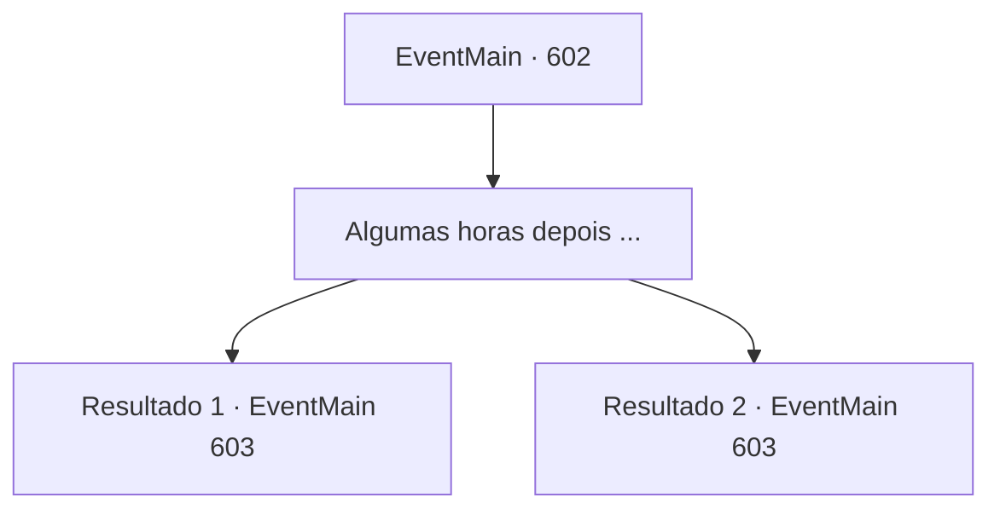

# Eventos principais · 602

[Índice da tabela](index.md) · [Índice geral](../index.md)

ID: `pt:EventMain:602` · Fonte: `EventMain4` · Versão: 1.2.47.

Mapeamento estático dos arquivos; a disponibilidade e a execução dependem do estado da run.

## Texto do evento

*Sem texto no arquivo.*

## Dados de entrada

```json
{
  "id": 602,
  "grade": 1,
  "normalGoal": "",
  "required": ""
}
```

## Mapa das escolhas



## Escolhas e resultados

### Escolha 1

Algumas horas depois ...

Requisitos e outros campos da escolha:

```json
{
  "required": ""
}
```

#### Resultado 1.1

Algumas horas após a cerimônia, Gess vem até você, que está descansando no esconderijo. 

 "Th, Eles estão aqui! Dani, Danica...!"

 Nas palavras de Gess, você sai do porão, se esconde em um prédio abandonado e verifica sua aparência. Olhando para ela sem fôlego, você pode ver a sacerdotisa Halfling com cabelos cacheados castanhos e vestindo uma batina curta de sacerdotisa. Ao redor dela estão vários paladinos que estão olhando para o altar. |drawing_danica|

Continuação registrada: [Evento 603](0603.md) na mesma tabela.

```json
{
  "required": "5_388_1",
  "chance": "1",
  "nextEvent": 603,
  "type": 2,
  "reward": ""
}
```

#### Resultado 1.2

Você não pôde realizar a cerimônia porque não conseguiu o sacrifício. Mas de qualquer forma, o plano de Gess se encaixa. Talvez os paladinos tenham ouvido de alguém sobre o seu paradeiro. E eles vêm para a Vila Kahida. Eles começam a procurar a vila com guardas. 

 "Ali. Aquela, Aquela halfling é Da, Danica."

 Você sai do porão, se esconde em um prédio abandonado e verifica sua aparência. Ela tem cabelos cacheados castanhos e roupas curtas de sacerdotisa e parece protegida pelos paladinos ao seu redor. Gess pergunta o que você vai fazer agora. |drawing_danica|

Continuação registrada: [Evento 603](0603.md) na mesma tabela.

```json
{
  "required": "18_388_1",
  "chance": "1",
  "nextEvent": 603,
  "type": 2,
  "reward": ""
}
```

## Referências que chegam a este evento

- [Evento 600 · escolha 1 · resultado 1](0600.md#escolha-1)
- [Evento 600 · escolha 1 · resultado 2](0600.md#escolha-1)
- [Evento 600 · escolha 2 · resultado 1](0600.md#escolha-2)
- [Evento 601 · escolha 1 · resultado 1](0601.md#escolha-1)
- [Evento 601 · escolha 2 · resultado 1](0601.md#escolha-2)
