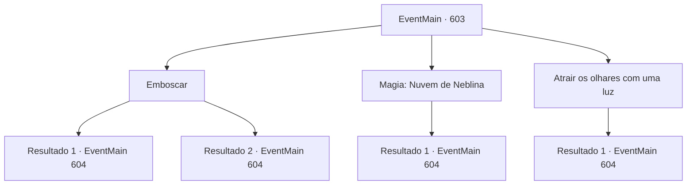

# Eventos principais · 603

[Índice da tabela](index.md) · [Índice geral](../index.md)

ID: `pt:EventMain:603` · Fonte: `EventMain4` · Versão: 1.2.47.

Mapeamento estático dos arquivos; a disponibilidade e a execução dependem do estado da run.

## Texto do evento

*Sem texto no arquivo.*

## Dados de entrada

```json
{
  "id": 603,
  "grade": 1,
  "normalGoal": "",
  "required": ""
}
```

## Mapa das escolhas



## Escolhas e resultados

### Escolha 1

Emboscar

Requisitos e outros campos da escolha:

```json
{
  "required": ""
}
```

#### Resultado 1.1

Você se prepara para uma luta chamando adoradores na caverna subterrânea. Enquanto observa os paladinos procurando ao redor, você procura uma chance de atacar secretamente. E você tem sucesso em fazer um ataque surpresa. Os paladinos ficam envergonhados com o ataque e sacam suas armas. 

 "E, inimigos se aproximando! Todos! Prontos para a batalha!"

 Ouvindo a voz urgente de Danica, você entra na batalha.

Continuação registrada: [Evento 604](0604.md) na mesma tabela.

```json
{
  "required": "",
  "chance": "1|0_6_1",
  "nextEvent": 604,
  "type": 0,
  "reward": "6_2_50",
  "place": 4
}
```

#### Resultado 1.2

Você se prepara para uma luta chamando adoradores na caverna subterrânea. Enquanto observa os paladinos procurando ao redor, você procura uma chance de saquear secretamente. Mas o plano falha. 

 "Inimigos se aproximando! Todos! Prontos para a batalha!"

 Ao grito urgente de Danica, os paladinos rapidamente sacaram suas armas e interromperam o ataque dos adoradores. Com uma batalha repentina entre paladinos e adoradores, Kahida se transforma no meio do campo de batalha.

Continuação registrada: [Evento 604](0604.md) na mesma tabela.

```json
{
  "required": "",
  "chance": "14",
  "nextEvent": 604,
  "type": 1,
  "reward": "6_0_50",
  "place": 4
}
```

### Escolha 2

Magia: Nuvem de Neblina

Requisitos e outros campos da escolha:

```json
{
  "required": "20_0_3|1_1_2"
}
```

#### Resultado 2.1

Você conjura Nuvem de Neblina e embaça a Kahida. Na neblina repentina, os paladinos interrompem a busca e sacam suas armas. Você lidera os adoradores silenciosamente em direção a eles e os ataca de surpresa. 

 "Argh -!"

 Quando o paladino grita, Danica grita urgentemente. 

 "E, inimigos se aproximando! Todos! Prontos para a batalha!"

 Com uma batalha repentina entre paladinos e adoradores, a Kahida se transforma no meio do campo de batalha.

Continuação registrada: [Evento 604](0604.md) na mesma tabela.

```json
{
  "required": "",
  "chance": "1",
  "nextEvent": 604,
  "type": 2,
  "reward": "0_1_-1|6_2_50",
  "place": 4
}
```

### Escolha 3

Atrair os olhares com uma luz

Requisitos e outros campos da escolha:

```json
{
  "required": "23_3_1"
}
```

#### Resultado 3.1

Você instrui um dos adoradores a fazer uma fogueira ao longe. O adorador que recebeu a ordem secretamente vai para o lado da vila de acordo com a ordem. Depois de um tempo, à medida que o fogo sobe ao longe, os paladinos se voltam para ele. 

 "Esperem! A luz ali...!"

 Com Danica olhando para as luzes e gritando, você lidera os adoradores e ataca os paladinos. Distraídos pela luz, os paladinos tiram suas armas embaraçados. 

 "E, inimigos se aproximando! Todos! Prontos para a batalha!"

 Com uma batalha repentina entre paladinos e adoradores, a Kahida se transforma no meio do campo de batalha.

Continuação registrada: [Evento 604](0604.md) na mesma tabela.

```json
{
  "required": "",
  "chance": "1",
  "nextEvent": 604,
  "type": 2,
  "reward": "25_3_1|6_2_50",
  "place": 4
}
```

## Referências que chegam a este evento

- [Evento 602 · escolha 1 · resultado 1](0602.md#escolha-1)
- [Evento 602 · escolha 1 · resultado 2](0602.md#escolha-1)
