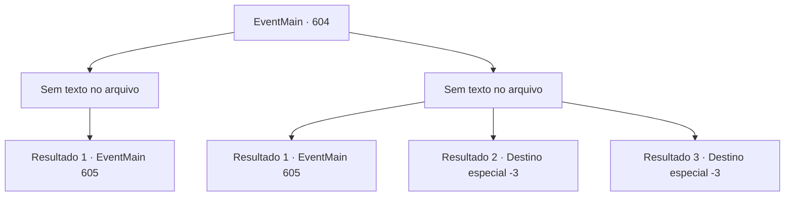

# Eventos principais · 604

[Índice da tabela](index.md) · [Índice geral](../index.md)

ID: `pt:EventMain:604` · Fonte: `EventMain4` · Versão: 1.2.47.

Mapeamento estático dos arquivos; a disponibilidade e a execução dependem do estado da run.

## Texto do evento

*Sem texto no arquivo.*

## Dados de entrada

```json
{
  "id": 604,
  "grade": 1,
  "normalGoal": "",
  "required": ""
}
```

## Mapa das escolhas



## Escolhas e resultados

### Escolha 1

*Sem texto no arquivo; o papel dessa opção depende da interface do jogo.*

Requisitos e outros campos da escolha:

```json
{
  "required": ""
}
```

#### Resultado 1.1

Você derruba todos os paladinos com os adoradores, roubando suas almas. E você arrasta Danica para se esconder como o espólio do vencedor. 

 "Você não tem medo da raiva de Tere? Me deixe ir!"

 Danica grita, citando o nome de Deus, mas são os adoradores do demônio ao seu redor. Eles apenas riem dela. 

 "Nós, nós a interrogaremos. Por favor, descanse."

 Gess se curva para você e te cumprimenta, arrastando Danica mais profundamente no subsolo. E os adoradores removem os corpos dos paladinos.

Continuação registrada: [Evento 605](0605.md) na mesma tabela.

```json
{
  "required": "",
  "chance": "1",
  "nextEvent": 605,
  "type": 2,
  "reward": ""
}
```

### Escolha 2

*Sem texto no arquivo; o papel dessa opção depende da interface do jogo.*

Requisitos e outros campos da escolha:

```json
{
  "required": ""
}
```

#### Resultado 2.1

Você e os adoradores enfrentam os paladinos, mas as coisas pioram.  Mas naquele momento, a maré muda quando Gess agarra Danica.  Gess a mantém como refém e ameaça os paladinos.  

 "Tosse... Estou bem..."

  Danica diz para ela não se preocupar consigo mesma, mas os paladinos não conseguem tomar decisões facilmente.  Enquanto isso, você, Gess e alguns adoradores fogem com Danica,  O restante dos adoradores ataca os paladinos. 

 "Nós, nós a interrogaremos. Por favor, descanse."

 Gess se curva para você e te cumprimenta, arrastando Danica para mais fundo no subsolo. E os adoradores removem os corpos dos paladinos.

Continuação registrada: [Evento 605](0605.md) na mesma tabela.

```json
{
  "required": "1_0_2|1_1_2",
  "chance": "1",
  "nextEvent": 605,
  "type": 2,
  "reward": "0_0_-1|0_1_-1"
}
```

#### Resultado 2.2

Você é esfaqueado nas costas por uma lança que você não viu. Uma espada ensanguentada voa em você enquanto você se ajoelha na dor repentina atrás de você. Você morreu antes de conseguir escapar da espada.

Continuação registrada: [Destino especial `-3`](../destinos-especiais.md).

```json
{
  "required": "2_0_2",
  "chance": "1",
  "nextEvent": -3,
  "type": 2,
  "reward": "0_0_-1|0_1_-1"
}
```

#### Resultado 2.3

Você é esfaqueado nas costas por uma lança que você não viu. Uma espada ensanguentada voa em você enquanto você se ajoelha na dor repentina atrás de você. Você morreu antes de conseguir escapar da espada.

Continuação registrada: [Destino especial `-3`](../destinos-especiais.md).

```json
{
  "required": "2_1_2",
  "chance": "1",
  "nextEvent": -3,
  "type": 2,
  "reward": "0_0_-1|0_1_-1"
}
```

## Referências que chegam a este evento

- [Evento 603 · escolha 1 · resultado 1](0603.md#escolha-1)
- [Evento 603 · escolha 1 · resultado 2](0603.md#escolha-1)
- [Evento 603 · escolha 2 · resultado 1](0603.md#escolha-2)
- [Evento 603 · escolha 3 · resultado 1](0603.md#escolha-3)
