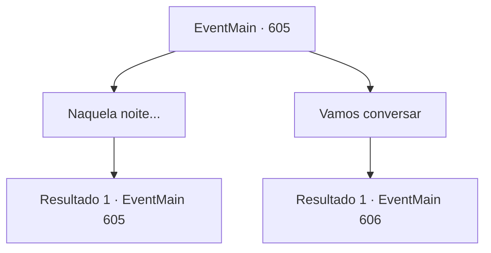

# Eventos principais · 605

[Índice da tabela](index.md) · [Índice geral](../index.md)

ID: `pt:EventMain:605` · Fonte: `EventMain4` · Versão: 1.2.47.

Mapeamento estático dos arquivos; a disponibilidade e a execução dependem do estado da run.

## Texto do evento

*Sem texto no arquivo.*

## Dados de entrada

```json
{
  "id": 605,
  "grade": 1,
  "normalGoal": "",
  "required": ""
}
```

## Mapa das escolhas



## Escolhas e resultados

### Escolha 1

Naquela noite...

Requisitos e outros campos da escolha:

```json
{
  "required": "5_389_0"
}
```

#### Resultado 1.1

Naquela noite, você visita a prisão e pede a Gess informações que ele encontrou. 

 "Oh... Sh, ela disse, ela só vai falar quando encontrar o contratante. Senhor..."

 Você olha para Danica ouvindo Gess. Seu rosto está muito inchado e seus tornozelos estão acorrentados. E o uniforme do padre está manchado de sangue, então a cor original é desconhecida.

Continuação registrada: [Evento 605](0605.md) na mesma tabela.

```json
{
  "required": "",
  "chance": "1",
  "nextEvent": 605,
  "type": 2,
  "reward": "5_389_1"
}
```

### Escolha 2

Vamos conversar

Requisitos e outros campos da escolha:

```json
{
  "required": "5_389_1"
}
```

#### Resultado 2.1

Você abre a porta da prisão e se aproxima de Danica. Gess então se curva e rapidamente se retira. Conforme você se aproxima, Danica, deitada, abre lentamente os olhos. Ela fala sobre o que ouviu de Gess, sua situação. 

 "É você... Queimado na fogueira... Eu entendo o que você sente, mas... Eu não pude evitar. Porque..."

 Danica solta suas palavras com dificuldade. 

 "Seu cônjuge fez um pacto com o demônio... Kior. Você também está sendo manipulado pelo demônio."

 Ela olha para você com os olhos inchados. Seus olhos não desviam do seu olhar, enquanto ela afirma não estar mentindo.

Continuação registrada: [Evento 606](0606.md) na mesma tabela.

```json
{
  "required": "",
  "chance": "1",
  "nextEvent": 606,
  "type": 2,
  "reward": "5_389_2"
}
```

## Referências que chegam a este evento

- [Evento 604 · escolha 1 · resultado 1](0604.md#escolha-1)
- [Evento 604 · escolha 2 · resultado 1](0604.md#escolha-2)
- [Evento 605 · escolha 1 · resultado 1](0605.md#escolha-1)
