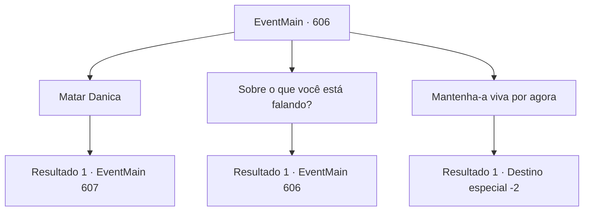

# Eventos principais · 606

[Índice da tabela](index.md) · [Índice geral](../index.md)

ID: `pt:EventMain:606` · Fonte: `EventMain4` · Versão: 1.2.47.

Mapeamento estático dos arquivos; a disponibilidade e a execução dependem do estado da run.

## Texto do evento

*Sem texto no arquivo.*

## Dados de entrada

```json
{
  "id": 606,
  "grade": 1,
  "normalGoal": "",
  "required": ""
}
```

## Mapa das escolhas



## Escolhas e resultados

### Escolha 1

Matar Danica

Requisitos e outros campos da escolha:

```json
{
  "required": ""
}
```

#### Resultado 1.1

Você torce o pescoço de Danica, entregando-lhe o fim. Nesse exato momento, de repente, a voz de Kior sai da minha cabeça. 

 "É uma boa oportunidade. {1}. Coloque sua mão em seu rosto porque seu corpo ainda tem uma alma. Então você será capaz de absorver a alma."

 Você coloca sua mão em seu rosto como Kior disse. Então uma névoa pálida e densa flui de cada buraco no rosto de Danica. É sua alma. Enquanto você absorve toda a alma de Danica e tira as mãos, você ouve a risada de Kior. Você olha para o corpo dela com uma estranha sensação de exaltação. Então, Gess fala com você. 

 "Ho, E que tal pendurar o corpo de Da, Danica em um p, poste? Seria um g, grande insulto para T, Tere."


Continuação registrada: [Evento 607](0607.md) na mesma tabela.

```json
{
  "required": "",
  "chance": "1",
  "nextEvent": 607,
  "type": 2,
  "reward": ""
}
```

### Escolha 2

Sobre o que você está falando?

Requisitos e outros campos da escolha:

```json
{
  "required": "5_389_2"
}
```

#### Resultado 2.1

Você pergunta a Danica o que ela quer dizer com isso. Mas Kior sussurra mais rápido do que ela. 

 "Uau... O padre de Tere fala sobre qualquer coisa porque ela quer viver."

 Kior fala em sua cabeça e nega suas palavras. 

 "Você não precisa ouvir... Agora, dedique sua alma a mim."

 Danica diz como se estivesse refutando o que Kior diz. 

 "É verdade, eu... Eu posso provar."

 Danica respira fundo e balança os lábios, abaixando a cabeça. Gess olha para ela e diz que ela parece ter desmaiado por um tempo. Então, ele pergunta cautelosamente, 'O que você vai fazer?'

Continuação registrada: [Evento 606](0606.md) na mesma tabela.

```json
{
  "required": "",
  "chance": "1",
  "nextEvent": 606,
  "type": 2,
  "reward": "5_389_3"
}
```

### Escolha 3

Mantenha-a viva por agora

Requisitos e outros campos da escolha:

```json
{
  "required": "5_389_3"
}
```

#### Resultado 3.1

Você responde a ele para manter Danica viva por enquanto. E você sai do esconderijo para descobrir a verdade sobre a morte de sua família pessoalmente. Gess, que te seguiu atrasado, fala com voz trêmula. 

 "Nós entraremos em contato assim que o próximo plano estiver pronto"

 Você acena com a cabeça para Gess e deixa a vila de Kahida. Gess se curva até você estar completamente fora de vista.

Continuação registrada: [Destino especial `-2`](../destinos-especiais.md).

```json
{
  "required": "",
  "chance": "1",
  "nextEvent": -2,
  "type": 2,
  "reward": "13_4_8"
}
```

## Referências que chegam a este evento

- [Evento 605 · escolha 2 · resultado 1](0605.md#escolha-2)
- [Evento 606 · escolha 2 · resultado 1](0606.md#escolha-2)
