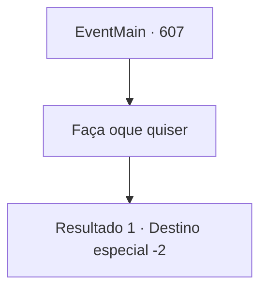

# Eventos principais · 607

[Índice da tabela](index.md) · [Índice geral](../index.md)

ID: `pt:EventMain:607` · Fonte: `EventMain4` · Versão: 1.2.47.

Mapeamento estático dos arquivos; a disponibilidade e a execução dependem do estado da run.

## Texto do evento

*Sem texto no arquivo.*

## Dados de entrada

```json
{
  "id": 607,
  "grade": 1,
  "normalGoal": "",
  "required": ""
}
```

## Mapa das escolhas



## Escolhas e resultados

### Escolha 1

Faça oque quiser

Requisitos e outros campos da escolha:

```json
{
  "required": ""
}
```

#### Resultado 1.1

Você fala com Gess para fazer qualquer coisa que ele queira fazer com o corpo de Danica. Gess então se curva educadamente e sorri de forma estranha. 

 "Entendi. Hehehe... Então entrarei em contato com você assim que o próximo plano estiver pronto."

 Você se despede de Gess e sai do esconderijo.

Continuação registrada: [Destino especial `-2`](../destinos-especiais.md).

```json
{
  "required": "",
  "chance": "1",
  "nextEvent": -2,
  "type": 2,
  "reward": "13_4_7"
}
```

## Referências que chegam a este evento

- [Evento 606 · escolha 1 · resultado 1](0606.md#escolha-1)
