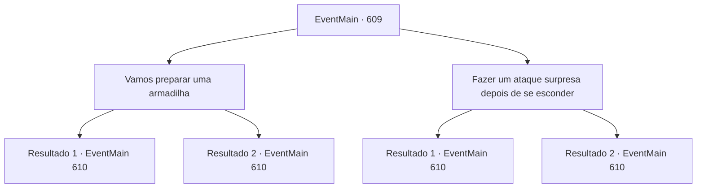

# Eventos principais · 609

[Índice da tabela](index.md) · [Índice geral](../index.md)

ID: `pt:EventMain:609` · Fonte: `EventMain4` · Versão: 1.2.47.

Mapeamento estático dos arquivos; a disponibilidade e a execução dependem do estado da run.

## Texto do evento

*Sem texto no arquivo.*

## Dados de entrada

```json
{
  "id": 609,
  "grade": 1,
  "normalGoal": "",
  "required": ""
}
```

## Mapa das escolhas



## Escolhas e resultados

### Escolha 1

Vamos preparar uma armadilha

Requisitos e outros campos da escolha:

```json
{
  "required": ""
}
```

#### Resultado 1.1

Você concordou com Gess e preparou rapidamente a armadilha. Então, junto com os adoradores, você colocou uma rede no teto, montou uma linha no chão e esperou pelos santos. Dentro de cinco minutos de se esconder, os paladinos correm para a caverna. 

 "Ninguém fica para trás!... O que?!"

 Os paladinos, que tocam a linha no chão, logo são pegos em uma rede que cai do teto. Imediatamente depois, você corre para os paladinos lutando junto com os adoradores. 

 "Kek! Eu não sabia que você faria um truque desses. {1}!"

 Então, você volta seus olhos para a voz de alguém que te chama. Há um Viyork que te deu informações da última vez. Ele quebra a rede às pressas e corre em sua direção.

Continuação registrada: [Evento 610](0610.md) na mesma tabela.

```json
{
  "required": "",
  "chance": "1|0_7_1",
  "nextEvent": 610,
  "type": 0,
  "reward": "6_2_147",
  "place": 6
}
```

#### Resultado 1.2

Você concordou com Gess e preparou rapidamente a armadilha. Então, junto com os adoradores, você colocou uma rede no teto, montou uma linha no chão e esperou pelos santos. Dentro de cinco minutos de se esconder, os paladinos correm para a caverna. A armadilha é inútil. Os paladinos percebem a armadilha, atravessam a linha e te atacam. 

 "Estamos nos encontrando aqui. {1}!"

 No meio da luta, você se vira para a voz de alguém. Há um Viyork que te deu as informações da última vez, brandindo uma espada contra você.

Continuação registrada: [Evento 610](0610.md) na mesma tabela.

```json
{
  "required": "",
  "chance": "14",
  "nextEvent": 610,
  "type": 1,
  "reward": "6_0_147",
  "place": 6
}
```

### Escolha 2

Fazer um ataque surpresa depois de se esconder

Requisitos e outros campos da escolha:

```json
{
  "required": ""
}
```

#### Resultado 2.1

Você aceita as palavras de Gess e se esconde para um ataque surpresa. Então Gess responde que ele será a isca e chamará a atenção. Depois de um tempo, você espera pelos paladinos, escondido com os adoradores sem Gess. Menos de cinco minutos depois de se esconder, os paladinos entram na caverna. 

 "Ali! Mate-o!"

 Felizmente, os paladinos correm em direção a Gess sem perceber você e os adoradores escondidos. Você ataca pelas costas com os adoradores. 

 "Kek! Eu não sabia que você faria um truque desses. {1}!"

 Então, você volta seus olhos para a voz de alguém que te chama. Há um Viyork que te deu informações da última vez, brandindo uma espada contra você.

Continuação registrada: [Evento 610](0610.md) na mesma tabela.

```json
{
  "required": "",
  "chance": "1|0_6_1",
  "nextEvent": 610,
  "type": 0,
  "reward": "6_2_147",
  "place": 6
}
```

#### Resultado 2.2

Você aceita as palavras de Gess e se esconde para um ataque surpresa. Então Gess responde que ele será a isca e chamará a atenção. Depois de um tempo, você espera pelos paladinos, se escondendo com os adoradores sem Gess. Menos de cinco minutos depois de se esconder, os paladinos entram na caverna. 

 "Ali!..."

 Infelizmente, os paladinos não correm diretamente para Gess, mas param e olham para o lugar onde você está escondido. As emboscadas são encontradas com o sentido dos paladinos que detectam demônios. 

 "Há uma emboscada ali! Todos, cuidado!"

 Você vai direto aos paladinos. 

 "Nos encontramos aqui. {1}!"

 No meio da luta, você se vira para a voz de alguém. Há um Viyork que lhe deu informações da última vez, brandindo uma espada contra você.

Continuação registrada: [Evento 610](0610.md) na mesma tabela.

```json
{
  "required": "",
  "chance": "14",
  "nextEvent": 610,
  "type": 1,
  "reward": "6_0_147",
  "place": 6
}
```

## Referências que chegam a este evento

- [Evento 608 · escolha 1 · resultado 1](0608.md#escolha-1)
- [Evento 631 · escolha 1 · resultado 1](0631.md#escolha-1)
