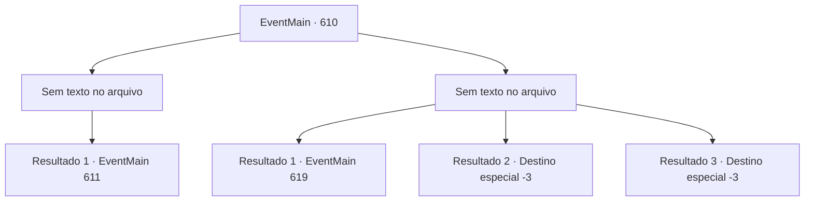

# Eventos principais · 610

[Índice da tabela](index.md) · [Índice geral](../index.md)

ID: `pt:EventMain:610` · Fonte: `EventMain4` · Versão: 1.2.47.

Mapeamento estático dos arquivos; a disponibilidade e a execução dependem do estado da run.

## Texto do evento

*Sem texto no arquivo.*

## Dados de entrada

```json
{
  "id": 610,
  "grade": 1,
  "normalGoal": "",
  "required": ""
}
```

## Mapa das escolhas



## Escolhas e resultados

### Escolha 1

*Sem texto no arquivo; o papel dessa opção depende da interface do jogo.*

Requisitos e outros campos da escolha:

```json
{
  "required": ""
}
```

#### Resultado 1.1

Você chuta o corpo do paladino e se aproxima de Viyork. O assustado Viyork está olhando para você com uma expressão assustada. 

 "Oh meu Deus... Espere um minuto! Os paladinos estão cercados aqui! Se eu morrer, tenho certeza de que eles virão!"

 Viyork fala com uma voz trêmula, como se estivesse aterrorizado. 

 "Me salve. Eu vou dizer a eles para te tirarem do cerco. Então..."

 Você levanta sua arma diante do suplicante Viyork. Mas então, de repente, uma espada de alguém voa e bloqueia seu caminho. 

 "Felizmente, ainda não é tarde demais."

 Quem te bloqueou é um Lizardfolk, que tem escamas douradas e olhos rasgados verticalmente. Você corre em direção a Onil, despejando sua raiva fervente.

Continuação registrada: [Evento 611](0611.md) na mesma tabela.

```json
{
  "required": "",
  "chance": "1",
  "nextEvent": 611,
  "type": 2,
  "reward": "6_0_145",
  "place": 6
}
```

### Escolha 2

*Sem texto no arquivo; o papel dessa opção depende da interface do jogo.*

Requisitos e outros campos da escolha:

```json
{
  "required": ""
}
```

#### Resultado 2.1

Você foi derrotado pelos paladinos que atacaram o esconderijo. Os adoradores foram eliminados, e você se ajoelha com a espada de Viyork. 

 "Tsk. Arraste-o!"

 Sob o comando de Viyork, os paladinos começam a te levar para algum lugar. Você consegue ver o rosto sorridente de Viyork com visão embaçada. 

 De repente, você acorda e olha ao redor lentamente. É uma sala com paredes de pedra, sem lugar para escapar, uma barra de ferro forte na frente e uma corrente em seu pulso. Antes que você perceba, está na prisão. 

 "Hmm. Você está acordado."

 Você vira os olhos para o som vindo de fora das grades de aço. Na escuridão, um velho vestido com um traje sacerdotal vermelho brilhante aparece com uma tocha. |drawing_publius|

Continuação registrada: [Evento 619](0619.md) na mesma tabela.

```json
{
  "required": "1_0_2|1_1_2",
  "chance": "1",
  "nextEvent": 619,
  "type": 2,
  "reward": "0_0_-1|0_1_-1"
}
```

#### Resultado 2.2

Você foi derrotado pelos paladinos que atacaram o esconderijo. Os adoradores foram eliminados, e você se ajoelha com a espada de Viyork. 

 "Tsk. Você está morto?"

 O som da língua de Viyork sendo chutada na consciência turva.

Continuação registrada: [Destino especial `-3`](../destinos-especiais.md).

```json
{
  "required": "2_0_2",
  "chance": "1",
  "nextEvent": -3,
  "type": 2,
  "reward": "0_0_-1|0_1_-1"
}
```

#### Resultado 2.3

Você foi derrotado pelos paladinos que atacaram o esconderijo. Os adoradores foram eliminados, e você se ajoelha com a espada de Viyork. 

 "Tsk. Você está morto?"

 O som da língua de Viyork sendo chutada na consciência turva.

Continuação registrada: [Destino especial `-3`](../destinos-especiais.md).

```json
{
  "required": "2_1_2",
  "chance": "1",
  "nextEvent": -3,
  "type": 2,
  "reward": "0_0_-1|0_1_-1"
}
```

## Referências que chegam a este evento

- [Evento 609 · escolha 1 · resultado 1](0609.md#escolha-1)
- [Evento 609 · escolha 1 · resultado 2](0609.md#escolha-1)
- [Evento 609 · escolha 2 · resultado 1](0609.md#escolha-2)
- [Evento 609 · escolha 2 · resultado 2](0609.md#escolha-2)
- [Evento 613 · escolha 1 · resultado 2](0613.md#escolha-1)
