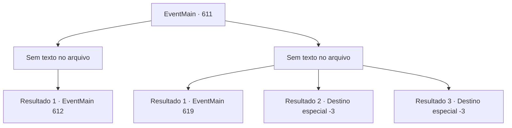

# Eventos principais · 611

[Índice da tabela](index.md) · [Índice geral](../index.md)

ID: `pt:EventMain:611` · Fonte: `EventMain4` · Versão: 1.2.47.

Mapeamento estático dos arquivos; a disponibilidade e a execução dependem do estado da run.

## Texto do evento

*Sem texto no arquivo.*

## Dados de entrada

```json
{
  "id": 611,
  "grade": 1,
  "normalGoal": "",
  "required": ""
}
```

## Mapa das escolhas



## Escolhas e resultados

### Escolha 1

*Sem texto no arquivo; o papel dessa opção depende da interface do jogo.*

Requisitos e outros campos da escolha:

```json
{
  "required": ""
}
```

#### Resultado 1.1

Onil, que luta bravamente, acaba de joelhos. Você coloca uma arma em sua garganta, perguntando: 'Você se lembra de mim?'. Ele levanta a cabeça com dificuldade e olha para você com um olhar embaçado. 

 "... Você foi queimado! Como... Viver... Tosse!"

 Toda vez que Onil tosse, sangue derrama. Mas ele não para de falar, mesmo sentindo que sua morte está se aproximando. 

 "Vingança?... sua família... queimada... Isso é... justiça..."


Continuação registrada: [Evento 612](0612.md) na mesma tabela.

```json
{
  "required": "",
  "chance": "1",
  "nextEvent": 612,
  "type": 2,
  "reward": "3_249_1"
}
```

### Escolha 2

*Sem texto no arquivo; o papel dessa opção depende da interface do jogo.*

Requisitos e outros campos da escolha:

```json
{
  "required": ""
}
```

#### Resultado 2.1

Você, ferido pela espada de Onil, ajoelhe-se. O corpo não está energizado e a consciência gradualmente se torna turva. 

 "Pegue. Eu levarei para o Arcebispo."

 A voz de Onil é ouvida na consciência desvanecida.

 De repente, você acorda e olha ao redor lentamente. É uma sala com paredes de pedra sem saída, uma barra de ferro forte na frente e uma corrente no seu pulso. Antes que você perceba, está na prisão. 

 "Hmm. Você está acordado."

 Você vira os olhos para o som vindo de fora das grades de aço. Na escuridão, um velho vestido com um traje sacerdotal vermelho brilhante bordado aparece com uma tocha. |drawing_publius|

Continuação registrada: [Evento 619](0619.md) na mesma tabela.

```json
{
  "required": "1_0_2|1_1_2",
  "chance": "1",
  "nextEvent": 619,
  "type": 2,
  "reward": "0_0_-1|0_1_-1"
}
```

#### Resultado 2.2

A espada fria de Onil perfura sua barriga. Naquela dor tonta, você vomita sangue, e Onil empurra a espada novamente. 

 "Por favor, nasça como uma pessoa inocente em sua próxima vida."

 Você está tentando se agarrar à consciência embaçada, A morte não pode ser evitada.

Continuação registrada: [Destino especial `-3`](../destinos-especiais.md).

```json
{
  "required": "2_0_2",
  "chance": "1",
  "nextEvent": -3,
  "type": 2,
  "reward": "0_0_-1|0_1_-1"
}
```

#### Resultado 2.3

A espada fria de Onil perfura sua barriga. Naquela dor tonta, você vomita sangue, e Onil empurra a espada novamente. 

 "Por favor, nasça como uma pessoa inocente em sua próxima vida."

 Você está tentando se agarrar à consciência embaçada, A morte não pode ser evitada.

Continuação registrada: [Destino especial `-3`](../destinos-especiais.md).

```json
{
  "required": "2_1_2",
  "chance": "1",
  "nextEvent": -3,
  "type": 2,
  "reward": "0_0_-1|0_1_-1"
}
```

## Referências que chegam a este evento

- [Evento 610 · escolha 1 · resultado 1](0610.md#escolha-1)
