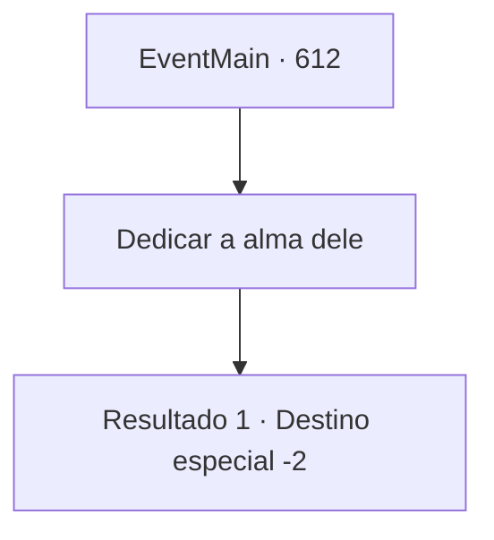

# Eventos principais · 612

[Índice da tabela](index.md) · [Índice geral](../index.md)

ID: `pt:EventMain:612` · Fonte: `EventMain4` · Versão: 1.2.47.

Mapeamento estático dos arquivos; a disponibilidade e a execução dependem do estado da run.

## Texto do evento

*Sem texto no arquivo.*

## Dados de entrada

```json
{
  "id": 612,
  "grade": 1,
  "normalGoal": "",
  "required": ""
}
```

## Mapa das escolhas



## Escolhas e resultados

### Escolha 1

Dedicar a alma dele

Requisitos e outros campos da escolha:

```json
{
  "required": ""
}
```

#### Resultado 1.1

|drawing_drain| Sem esperar por uma resposta, você toca o rosto de Onil. Então, assim como fez com Danica, você rouba sua alma. 

 "Kuhuuuk!...Khuk!..!!"

 Onil não suporta a dor e se contorce todo, e a névoa que sai dele é passada para Kior através da sua mão. Depois de um tempo, quando você absorve toda a alma de Onil, ele para de respirar. Você vira a cabeça e olha para o próximo bode expiatório, Viyork. Então, seu grito agudo explode. 

 "Meu Deus! Não, não! Recue!"

 De qualquer forma, você dá a Viyork o mesmo fim que deu a Onil. Enquanto as duas almas são devotadas, a risada satisfeita de Kior é ouvida. Logo depois, Gess diz, acenando. 

 "Vamos preparar uma estratégia até você voltar da próxima vez."

 Você acena para Gess e sai de lá.

Continuação registrada: [Destino especial `-2`](../destinos-especiais.md).

```json
{
  "required": "",
  "chance": "1",
  "nextEvent": -2,
  "type": 2,
  "reward": "13_4_10"
}
```

## Referências que chegam a este evento

- [Evento 611 · escolha 1 · resultado 1](0611.md#escolha-1)
