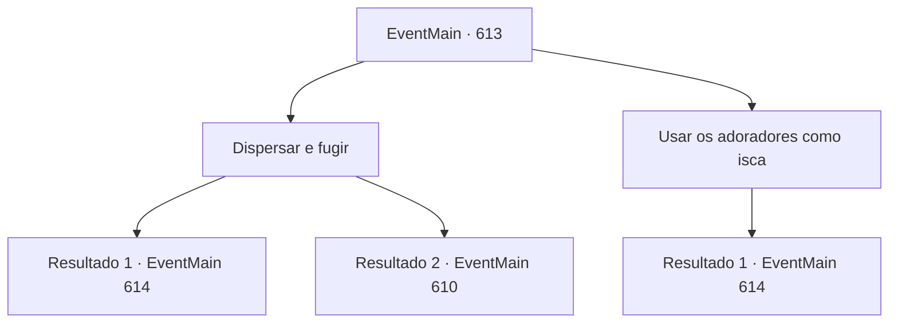

# Eventos principais · 613

[Índice da tabela](index.md) · [Índice geral](../index.md)

ID: `pt:EventMain:613` · Fonte: `EventMain4` · Versão: 1.2.47.

Mapeamento estático dos arquivos; a disponibilidade e a execução dependem do estado da run.

## Texto do evento

*Sem texto no arquivo.*

## Dados de entrada

```json
{
  "id": 613,
  "grade": 1,
  "normalGoal": "",
  "required": ""
}
```

## Mapa das escolhas



## Escolhas e resultados

### Escolha 1

Dispersar e fugir

Requisitos e outros campos da escolha:

```json
{
  "required": ""
}
```

#### Resultado 1.1

Você sugere se separar e fugir. Com isso, Gess concorda com a cabeça, tira um mapa de seus braços e mostra. Ele aponta para a cidade portuária de 'Dub' no mapa e diz. 

 "Existe uma guilda de ladrões lá. O líder deles é meu conhecido, então eles vão te ajudar."

 Mas antes mesmo de Gess terminar de falar, os paladinos entram e atacam os adoradores. Você e os adoradores do demônio correm para fugir.

 Alguns dias depois, você chega em Dub e tenta encontrar uma guilda de ladrões. No entanto, mesmo se você andar por muito tempo, não consegue encontrar um prédio semelhante, muito menos uma guilda de ladrões. Você se senta no banco e tenta descobrir como encontrá-la.

Continuação registrada: [Evento 614](0614.md) na mesma tabela.

```json
{
  "required": "",
  "chance": "1|0_6_1",
  "nextEvent": 614,
  "type": 0,
  "reward": ""
}
```

#### Resultado 1.2

Você sugere se separar e fugir. Com isso, Gess concorda, tira um mapa de seus braços e mostra. Ele aponta para a cidade portuária de 'Dub' no mapa e diz. 

 "O, Há uma gu, guilda de ladrões. O c, chefe deles é m, meu co, conhecido, então e, eles vão te ajudar."

 Mas antes mesmo de Gess terminar de falar, os paladinos entram e atacam os adoradores. Sem tempo para escapar, você não tem escolha a não ser lutar contra os paladinos. 

 "Estamos nos encontrando aqui. {1}!"

 No meio da luta, você se vira para a voz de alguém. Há um Viyork que lhe deu as informações da última vez, brandindo uma espada contra você.

Continuação registrada: [Evento 610](0610.md) na mesma tabela.

```json
{
  "required": "",
  "chance": "14",
  "nextEvent": 610,
  "type": 1,
  "reward": "6_0_147",
  "place": 6
}
```

### Escolha 2

Usar os adoradores como isca

Requisitos e outros campos da escolha:

```json
{
  "required": "2_3_0"
}
```

#### Resultado 2.1

Você sugere que Gess e os adoradores sejam isca. Você diz a eles que mesmo que morram, serão abençoados por Kior, e eles concordam com expressões extáticas. E Gess se aproxima de você, tira um mapa e mostra. 

 "Há uma guilda de ladrões. O líder deles é meu conhecido, então eles vão te ajudar."

 Mas antes mesmo de Gess terminar de falar, os paladinos entram e atacam os adoradores. Você e os adoradores do demônio correm para fugir.

 Alguns dias depois, você chega em Dub e tenta encontrar uma guilda de ladrões. No entanto, mesmo que você ande por muito tempo, não consegue encontrar um prédio semelhante, muito menos uma guilda de ladrões. Você se senta no banco e tenta descobrir como encontrá-la.

Continuação registrada: [Evento 614](0614.md) na mesma tabela.

```json
{
  "required": "",
  "chance": "1",
  "nextEvent": 614,
  "type": 2,
  "reward": ""
}
```

## Referências que chegam a este evento

- [Evento 608 · escolha 2 · resultado 1](0608.md#escolha-2)
- [Evento 631 · escolha 2 · resultado 1](0631.md#escolha-2)
