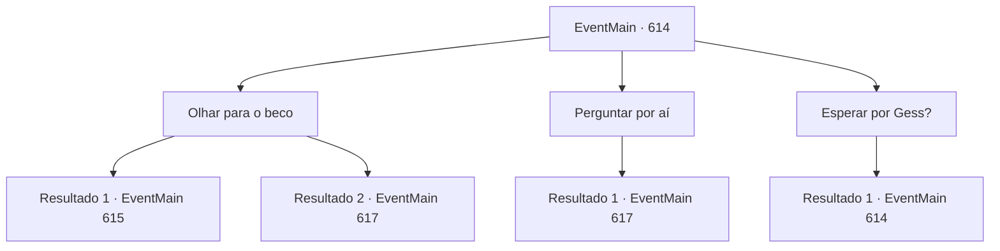

# Eventos principais · 614

[Índice da tabela](index.md) · [Índice geral](../index.md)

ID: `pt:EventMain:614` · Fonte: `EventMain4` · Versão: 1.2.47.

Mapeamento estático dos arquivos; a disponibilidade e a execução dependem do estado da run.

## Texto do evento

*Sem texto no arquivo.*

## Dados de entrada

```json
{
  "id": 614,
  "grade": 1,
  "normalGoal": "",
  "required": ""
}
```

## Mapa das escolhas



## Escolhas e resultados

### Escolha 1

Olhar para o beco

Requisitos e outros campos da escolha:

```json
{
  "required": "5_390_1"
}
```

#### Resultado 1.1

Olhando para o beco dos fundos, você encontra um bar suspeito. Ao entrar lá, você vê o homem que parece ser o dono guardando o bar sozinho. 

 "Estamos fechados hoje"

 Ele fala bruscamente sem olhar para você. Mas você percebe que ele está escondendo algo. Você se aproxima dele e diz que foi apresentado por Gess. Ele te observa por um momento e depois limpa o grande barril de carvalho no canto da loja. Então, as escadas secretas que estavam escondidas são reveladas.

Continuação registrada: [Evento 615](0615.md) na mesma tabela.

```json
{
  "required": "",
  "chance": "1|0_14_1",
  "nextEvent": 615,
  "type": 0,
  "reward": ""
}
```

#### Resultado 1.2

Olhando para o beco dos fundos, você encontra um bar suspeito. Ao entrar lá, você vê o homem que parece ser o dono guardando o bar sozinho. 

 "Estamos fechados hoje"

 Ele fala bruscamente sem olhar para você. Com essa atitude insensível, você sai do bar e encontra uma guilda de ladrões em outro lugar. Mas esse julgamento é um erro. Você encontra um paladino sem saber a localização da guilda de ladrões. 

 "Demônio! É melhor se render!"

 Quando o paladino te vê, ele corre em sua direção, puxando sua arma.

Continuação registrada: [Evento 617](0617.md) na mesma tabela.

```json
{
  "required": "",
  "chance": "16",
  "nextEvent": 617,
  "type": 1,
  "reward": "6_0_50",
  "place": 4
}
```

### Escolha 2

Perguntar por aí

Requisitos e outros campos da escolha:

```json
{
  "required": "5_390_1"
}
```

#### Resultado 2.1

Você caminha pela cidade e pergunta às pessoas sobre a guilda de ladrões. Mas esse julgamento é um erro. Você encontra um paladino sem saber a localização da guilda de ladrões. 

 "Demônio! É melhor se render!"

 Quando o paladino te vê, ele corre em sua direção, puxando sua arma.

Continuação registrada: [Evento 617](0617.md) na mesma tabela.

```json
{
  "required": "",
  "chance": "1",
  "nextEvent": 617,
  "type": 2,
  "reward": "6_0_50",
  "place": 4
}
```

### Escolha 3

Esperar por Gess?

Requisitos e outros campos da escolha:

```json
{
  "required": "5_390_0"
}
```

#### Resultado 3.1

Você se perguntou se esperaria até Gess e os adoradores chegarem. Mas como se para responder aos seus pensamentos, a voz de Kior é ouvida. 

 "Por que você está sentado em branco? Não me diga que você não acha que Gess está vindo, não é? Se alguém está vindo atrás de você, serão os homens de Tere. Levante-se e saia daí."


Continuação registrada: [Evento 614](0614.md) na mesma tabela.

```json
{
  "required": "",
  "chance": "1",
  "nextEvent": 614,
  "type": 2,
  "reward": "5_390_1"
}
```

## Referências que chegam a este evento

- [Evento 613 · escolha 1 · resultado 1](0613.md#escolha-1)
- [Evento 613 · escolha 2 · resultado 1](0613.md#escolha-2)
- [Evento 614 · escolha 3 · resultado 1](0614.md#escolha-3)
