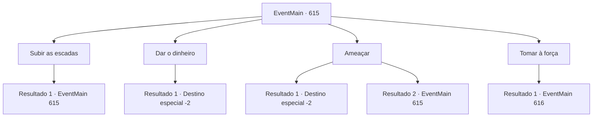

# Eventos principais · 615

[Índice da tabela](index.md) · [Índice geral](../index.md)

ID: `pt:EventMain:615` · Fonte: `EventMain4` · Versão: 1.2.47.

Mapeamento estático dos arquivos; a disponibilidade e a execução dependem do estado da run.

## Texto do evento

*Sem texto no arquivo.*

## Dados de entrada

```json
{
  "id": 615,
  "grade": 1,
  "normalGoal": "",
  "required": ""
}
```

## Mapa das escolhas



## Escolhas e resultados

### Escolha 1

Subir as escadas

Requisitos e outros campos da escolha:

```json
{
  "required": "5_391_0"
}
```

#### Resultado 1.1

Você desce cuidadosamente as escadas para um lugar escondido. O subsolo do bar secreto parece perigoso à primeira vista. De um lado da parede, armas como espadas, lanças, machados e barras de ferro estão penduradas; do outro, homens com rostos feios bebem. E uma mulher que estava fumando lá se aproxima de você. 

 "Prazer em conhecê-lo. Você é {1}, certo? Ouvi falar muito sobre você."

 A pessoa que o cumprimentou é uma mulher vestida com uma fantasia exótica chamada 'Jia'. Você explica a situação para ela e pede ajuda. Então ela tira um arquivo e o coloca na mesa. 

 "Hmm. Bom. Aqui está a informação que coletamos sobre Teretian. Vou dar por 200 ouros."

 Ela sorri, dizendo que é uma pechincha.

Continuação registrada: [Evento 615](0615.md) na mesma tabela.

```json
{
  "required": "",
  "chance": "1",
  "nextEvent": 615,
  "type": 2,
  "reward": "5_391_1"
}
```

### Escolha 2

Dar o dinheiro

Requisitos e outros campos da escolha:

```json
{
  "required": "5_391_1|1_4_200"
}
```

#### Resultado 2.1

Você simplesmente paga 200 ouro e recebe o arquivo. Diz que em breve haverá um festival na cidade metropolitana 'Hawa' no aniversário de Tere. E o Arcebispo de Tere, Publius, é responsável pelo festival. 

 "Esta é a última vez. Eu não quero antagonizar Teretian."

 Para você, olhando para o arquivo, Jia fala firmemente e fecha os lábios com força. Você sai dali silenciosamente.

Continuação registrada: [Destino especial `-2`](../destinos-especiais.md).

```json
{
  "required": "",
  "chance": "1",
  "nextEvent": -2,
  "type": 2,
  "reward": "13_4_12|0_4_-200"
}
```

### Escolha 3

Ameaçar

Requisitos e outros campos da escolha:

```json
{
  "required": "5_391_1|5_392_0"
}
```

#### Resultado 3.1

Você empurra uma arma em direção a ela e a ameaça para que ela a coloque para fora. Com sua atitude que parece atacar imediatamente, Jia coloca o arquivo para fora como se não pudesse evitar. Diz que em breve será realizado um festival na cidade metropolitana 'Hawa' no aniversário de Tere. E o Arcebispo de Tere, Publius, é responsável pelo festival. 

 "Esta é a última vez. Não quero antagonizar Teretian."

 Para você, olhando para o arquivo, Jia fala firmemente e fecha os lábios com força. Você sai de lá silenciosamente.

Continuação registrada: [Destino especial `-2`](../destinos-especiais.md).

```json
{
  "required": "",
  "chance": "1|0_12_1",
  "nextEvent": -2,
  "type": 0,
  "reward": "13_4_12"
}
```

#### Resultado 3.2

Você empurra uma arma em direção a ela e a ameaça para que ela a coloque para fora. Mas Jia não pisca diante da sua atitude de atacar imediatamente. 

 "Desculpe, mas acontecer assim acontece muito por aqui. Tem algo novo?"

 Jia ri de você, escondendo o arquivo debaixo da mesa.

Continuação registrada: [Evento 615](0615.md) na mesma tabela.

```json
{
  "required": "",
  "chance": "14",
  "nextEvent": 615,
  "type": 1,
  "reward": "5_392_1"
}
```

### Escolha 4

Tomar à força

Requisitos e outros campos da escolha:

```json
{
  "required": "5_391_1"
}
```

#### Resultado 4.1

Você decide retirar informações à força em vez de conversar. Ao se aproximar, empunhando sua arma, Jia chuta a mesa e aumenta a distância. Ela pega a maça de ferro pendurada no armário e olha para você com olhos tristes. 

 "Eu não quero fazer isso com o amigo de Gess..."

 Ao olhar ao redor, os homens que estavam bebendo de alguma forma te cercaram.

Continuação registrada: [Evento 616](0616.md) na mesma tabela.

```json
{
  "required": "",
  "chance": "1",
  "nextEvent": 616,
  "type": 2,
  "reward": "6_3_2",
  "place": 7
}
```

## Referências que chegam a este evento

- [Evento 614 · escolha 1 · resultado 1](0614.md#escolha-1)
- [Evento 615 · escolha 1 · resultado 1](0615.md#escolha-1)
- [Evento 615 · escolha 3 · resultado 2](0615.md#escolha-3)
