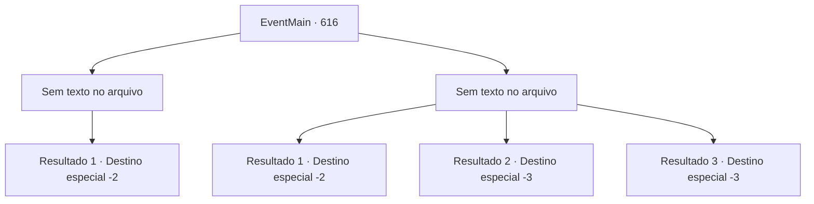

# Eventos principais · 616

[Índice da tabela](index.md) · [Índice geral](../index.md)

ID: `pt:EventMain:616` · Fonte: `EventMain4` · Versão: 1.2.47.

Mapeamento estático dos arquivos; a disponibilidade e a execução dependem do estado da run.

## Texto do evento

*Sem texto no arquivo.*

## Dados de entrada

```json
{
  "id": 616,
  "grade": 1,
  "normalGoal": "",
  "required": ""
}
```

## Mapa das escolhas



## Escolhas e resultados

### Escolha 1

*Sem texto no arquivo; o papel dessa opção depende da interface do jogo.*

Requisitos e outros campos da escolha:

```json
{
  "required": ""
}
```

#### Resultado 1.1

Você derruba todos os homens que te cercam e olha para Jia. Ela parece ter sentido que as chances estão contra você, abandonando silenciosamente a retirada e levantando as mãos. E ela diz, apontando para o arquivo na mesa com a ponta do queixo. 

 "...Pegue isso."

 Você pega o arquivo na mesa e olha para ele. Diz que em breve haverá um festival na cidade metropolitana 'Hawa' no aniversário de Tere. E o Arcebispo de Tere, Publius, é responsável pelo festival. 

 "Não há próxima vez. Não quero antagonizar Teretian."

 Jia termina em um tom firme e examina a condição dos homens caídos. De qualquer forma, você sai do bar quando alcançar seu objetivo.

Continuação registrada: [Destino especial `-2`](../destinos-especiais.md).

```json
{
  "required": "",
  "chance": "1",
  "nextEvent": -2,
  "type": 2,
  "reward": "13_4_12"
}
```

### Escolha 2

*Sem texto no arquivo; o papel dessa opção depende da interface do jogo.*

Requisitos e outros campos da escolha:

```json
{
  "required": ""
}
```

#### Resultado 2.1

Durante uma luta feroz, Jia diz vamos parar agora. E ela diz, apontando para o arquivo na mesa com a ponta do queixo. 

 "...Pegue isso."

 Você pega o arquivo na mesa e olha para ele. Diz que em breve será realizado um festival na cidade metropolitana 'Hawa' no aniversário de Tere. E o Arcebispo de Tere, Publius, é responsável pelo festival. 

 "Não há próxima vez. Eu não quero antagonizar Teretian."

 Jia termina em um tom firme e examina a condição dos homens caídos. De qualquer forma, você sai do bar quando alcança seu objetivo.

Continuação registrada: [Destino especial `-2`](../destinos-especiais.md).

```json
{
  "required": "1_0_2|1_1_2",
  "chance": "1",
  "nextEvent": -2,
  "type": 2,
  "reward": "0_0_-1|0_1_-1|13_4_12"
}
```

#### Resultado 2.2


 "Eu não quis te matar..."

 Espancado por homens, você perde a sanidade. A voz de Jia é a última lembrança de você.

Continuação registrada: [Destino especial `-3`](../destinos-especiais.md).

```json
{
  "required": "2_0_2",
  "chance": "1",
  "nextEvent": -3,
  "type": 2,
  "reward": "0_0_-1|0_1_-1"
}
```

#### Resultado 2.3


 "Eu não quis te matar..."

 Espancado por homens, você perde a sanidade. A voz de Jia é a última lembrança de você.

Continuação registrada: [Destino especial `-3`](../destinos-especiais.md).

```json
{
  "required": "2_1_2",
  "chance": "1",
  "nextEvent": -3,
  "type": 2,
  "reward": "0_0_-1|0_1_-1"
}
```

## Referências que chegam a este evento

- [Evento 615 · escolha 4 · resultado 1](0615.md#escolha-4)
