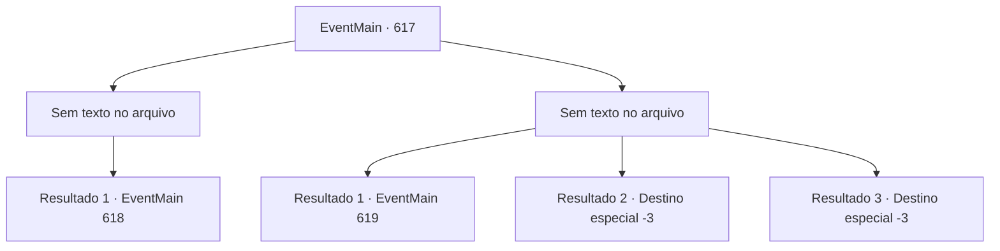

# Eventos principais · 617

[Índice da tabela](index.md) · [Índice geral](../index.md)

ID: `pt:EventMain:617` · Fonte: `EventMain4` · Versão: 1.2.47.

Mapeamento estático dos arquivos; a disponibilidade e a execução dependem do estado da run.

## Texto do evento

*Sem texto no arquivo.*

## Dados de entrada

```json
{
  "id": 617,
  "grade": 1,
  "normalGoal": "",
  "required": ""
}
```

## Mapa das escolhas



## Escolhas e resultados

### Escolha 1

*Sem texto no arquivo; o papel dessa opção depende da interface do jogo.*

Requisitos e outros campos da escolha:

```json
{
  "required": ""
}
```

#### Resultado 1.1

Você, que derrubou o paladino, usa violência para desenterrar informações. Mas ele é espancado por você, mas apenas repetidamente pedindo para você matá-lo. Então, a voz de Kior é ouvida. 

 "Hahahaha! Você está passando por muita coisa. Este corpo vai ajudar. Coloque sua mão em sua cabeça."

 Você coloca sua mão em sua cabeça enquanto Kior diz. Então, a mana escura que se estende de sua mão penetra na cabeça do homem. 

 "A--Arg-!! O que, o que é isso..! Ge--ekk!"

 Logo depois, a mana escura toma conta de sua cabeça. O globo ocular do homem fica preto. Ele murmura com uma expressão vaga quando você tira sua mão de sua cabeça. 

 "por... Kior..."

 Kior, que observa sua reação, sussurra para você. 'Agora ele está lavado cerebralmente, pergunte qualquer coisa'.

Continuação registrada: [Evento 618](0618.md) na mesma tabela.

```json
{
  "required": "",
  "chance": "1",
  "nextEvent": 618,
  "type": 2,
  "reward": ""
}
```

### Escolha 2

*Sem texto no arquivo; o papel dessa opção depende da interface do jogo.*

Requisitos e outros campos da escolha:

```json
{
  "required": ""
}
```

#### Resultado 2.1

A sua consciência está desaparecendo devido à dor intensa que se espalha por todo o seu corpo. 

 De repente, você acorda e olha ao redor lentamente.  É um quarto com paredes de pedra, sem lugar para escapar, uma barra de ferro forte na frente e uma corrente no seu pulso.  Antes que você perceba, está na prisão.  

 "Hmm. Você está acordado."

  Você vira os olhos para o som vindo de fora das grades de aço.  Na escuridão, um velho vestido com uma túnica vermelha ricamente bordada aparece com uma tocha.  |drawing_publius|

Continuação registrada: [Evento 619](0619.md) na mesma tabela.

```json
{
  "required": "1_0_2|1_1_2",
  "chance": "1",
  "nextEvent": 619,
  "type": 2,
  "reward": "0_0_-1|0_1_-1"
}
```

#### Resultado 2.2

Talvez seja porque você não teve um bom descanso, mas você é derrotado pelo paladino. A espada afiada voando é a última cena que você vê.

Continuação registrada: [Destino especial `-3`](../destinos-especiais.md).

```json
{
  "required": "2_0_2",
  "chance": "1",
  "nextEvent": -3,
  "type": 2,
  "reward": "0_0_-1|0_1_-1"
}
```

#### Resultado 2.3

Talvez seja porque você não teve um bom descanso, mas você é derrotado pelo paladino. A espada afiada voando é a última cena que você vê.

Continuação registrada: [Destino especial `-3`](../destinos-especiais.md).

```json
{
  "required": "2_1_2",
  "chance": "1",
  "nextEvent": -3,
  "type": 2,
  "reward": "0_0_-1|0_1_-1"
}
```

## Referências que chegam a este evento

- [Evento 614 · escolha 1 · resultado 2](0614.md#escolha-1)
- [Evento 614 · escolha 2 · resultado 1](0614.md#escolha-2)
