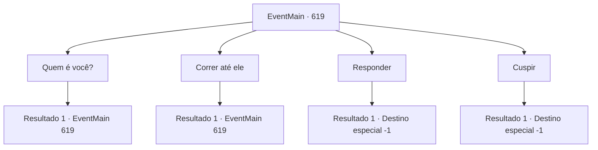

# Eventos principais · 619

[Índice da tabela](index.md) · [Índice geral](../index.md)

ID: `pt:EventMain:619` · Fonte: `EventMain4` · Versão: 1.2.47.

Mapeamento estático dos arquivos; a disponibilidade e a execução dependem do estado da run.

## Texto do evento

*Sem texto no arquivo.*

## Dados de entrada

```json
{
  "id": 619,
  "grade": 1,
  "normalGoal": "",
  "required": ""
}
```

## Mapa das escolhas



## Escolhas e resultados

### Escolha 1

Quem é você?

Requisitos e outros campos da escolha:

```json
{
  "required": "5_393_0"
}
```

#### Resultado 1.1

Você olha para o velho, perguntando quem ele é. Ele responde à sua pergunta tocando a barba que cobre seu rosto. Rugas profundas em sua testa chamam sua atenção. 

 "Eu sou Publius... Você entenderia se eu dissesse que sou o Arcebispo de Tere?"


Continuação registrada: [Evento 619](0619.md) na mesma tabela.

```json
{
  "required": "",
  "chance": "1",
  "nextEvent": 619,
  "type": 2,
  "reward": "5_393_1"
}
```

### Escolha 2

Correr até ele

Requisitos e outros campos da escolha:

```json
{
  "required": "5_393_1"
}
```

#### Resultado 2.1

Você corre em direção a Publius com uma corrente. Mas as barras de ferro frio na sua frente impedem que você o estrangule. Você colide com toda a sua força, mas as barras de ferro estão imbuidas de poder sagrado, e você apenas ricocheteia e rola no chão. Tudo o que você pode fazer é gritar para matá-lo. Olhando para baixo para você, o arcebispo abre a boca. 

 "Uma coisa. Eu te pergunto. Por que você fez isso? Você tem alguma rancor contra Danica?"


Continuação registrada: [Evento 619](0619.md) na mesma tabela.

```json
{
  "required": "",
  "chance": "1",
  "nextEvent": 619,
  "type": 2,
  "reward": "5_393_2"
}
```

### Escolha 3

Responder

Requisitos e outros campos da escolha:

```json
{
  "required": "5_393_2"
}
```

#### Resultado 3.1

Você grita com Publius e cospe o 'motivo da vingança'. Sua família foi queimada até a morte por uma acusação de que eles eram adoradores de demônios. Por causa disso, você assinou com Kior e começou a vingança. Quando você despeja toda a maldição e ressentimento, Publius suspira em voz baixa. 

 "É mesmo. Isso é ruim."

 Depois de um momento de silêncio, Publius balança a cabeça e continua. 

 "No entanto, o crime de atacar os clérigos de Tere e assinar um contrato com o demônio é grave. Você não conseguirá evitar a execução. Assim como sua família."

 Depois de falar, Publius sai silenciosamente da prisão, deixando você para trás. Um silêncio frio se instala dentro da prisão.

Continuação registrada: [Destino especial `-1`](../destinos-especiais.md).

```json
{
  "required": "",
  "chance": "1",
  "nextEvent": -1,
  "type": 2,
  "reward": "15_5_2|15_5_13"
}
```

### Escolha 4

Cuspir

Requisitos e outros campos da escolha:

```json
{
  "required": "5_393_2"
}
```

#### Resultado 4.1

Você cospe no rosto de Publius e se recusa a responder. Então Publius tira um lenço, limpa sua saliva e continua. 

 "Como você se atreve a atacar um membro do clero da ordem e o pecado de fazer um pacto com um demônio é gravemente severo. Você não pode evitar a execução, assim como sua família não pôde."

 Depois de falar, Publius sai silenciosamente da prisão, deixando você para trás. Um silêncio frio se instala dentro da prisão.

Continuação registrada: [Destino especial `-1`](../destinos-especiais.md).

```json
{
  "required": "",
  "chance": "1",
  "nextEvent": -1,
  "type": 2,
  "reward": "15_5_2|15_5_13"
}
```

## Referências que chegam a este evento

- [Evento 610 · escolha 2 · resultado 1](0610.md#escolha-2)
- [Evento 611 · escolha 2 · resultado 1](0611.md#escolha-2)
- [Evento 617 · escolha 2 · resultado 1](0617.md#escolha-2)
- [Evento 619 · escolha 1 · resultado 1](0619.md#escolha-1)
- [Evento 619 · escolha 2 · resultado 1](0619.md#escolha-2)
