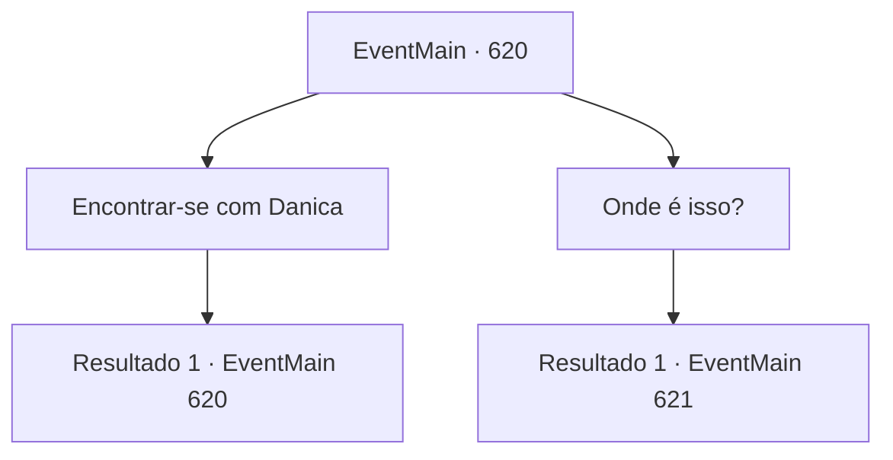

# Eventos principais · 620

[Índice da tabela](index.md) · [Índice geral](../index.md)

ID: `pt:EventMain:620` · Fonte: `EventMain4` · Versão: 1.2.47.

Mapeamento estático dos arquivos; a disponibilidade e a execução dependem do estado da run.

## Texto do evento

Você se encontrou novamente com os cultistas de Kior em uma caverna isolada. Como havia sequestrado Danica, não poderia mais usar a vila de Kahida como refúgio.  Com um sorriso estranho e nervoso, Gess o recebeu. 

 "Ah, ah, que bom que chegou, Co-Contratante... A verdade é que... Danica, ela... Ela disse que tem algo para lhe contar, h-hahaha..."


## Dados de entrada

```json
{
  "id": 620,
  "grade": 1,
  "normalGoal": "",
  "required": "1_2_50|13_4_8"
}
```

## Mapa das escolhas



## Escolhas e resultados

### Escolha 1

Encontrar-se com Danica

Requisitos e outros campos da escolha:

```json
{
  "required": "5_394_0"
}
```

#### Resultado 1.1

Você é guiado por Gess para visitar Danica. Danica está presa em uma prisão construída em uma caverna, parecendo mais emaciada do que da última vez que você a viu. Ao entrar na prisão, ela levanta a cabeça impotente e olha para você. 

 "Você veio... Cof! Eu tenho uma ideia... para saber o que... aconteceu com sua... família."

 Danica cospe saliva manchada de sangue e ofega. 

 "Isso é... 'O Espelho da Memória'"

 O Espelho da Memória, ela diz, é um artefato que mostra uma memória associada a um lugar ou objeto específico. Portanto, usá-lo permite que você saiba a verdade sobre sua família.

Continuação registrada: [Evento 620](0620.md) na mesma tabela.

```json
{
  "required": "",
  "chance": "1",
  "nextEvent": 620,
  "type": 2,
  "reward": "5_394_1"
}
```

### Escolha 2

Onde é isso?

Requisitos e outros campos da escolha:

```json
{
  "required": "5_394_1"
}
```

#### Resultado 2.1

Danica diz, respirando fundo diante da sua pergunta. 

 "Ofegante... Minha amiga Donna tem isso. Ela é uma astróloga que é parceira da nossa igreja."

 Ela detalha onde Donna está e pede sinceramente para você verificar. 

 "Você pode não acreditar em mim agora. Mas você não precisa se certificar, certo?"

 Danica fala com dificuldade, mas olha para você com olhos confiantes.

Continuação registrada: [Evento 621](0621.md) na mesma tabela.

```json
{
  "required": "",
  "chance": "1",
  "nextEvent": 621,
  "type": 2,
  "reward": "5_394_2"
}
```

## Referências que chegam a este evento

- [Evento 620 · escolha 1 · resultado 1](0620.md#escolha-1)
