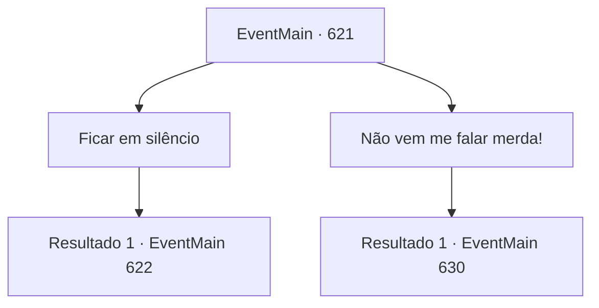

# Eventos principais · 621

[Índice da tabela](index.md) · [Índice geral](../index.md)

ID: `pt:EventMain:621` · Fonte: `EventMain4` · Versão: 1.2.47.

Mapeamento estático dos arquivos; a disponibilidade e a execução dependem do estado da run.

## Texto do evento

*Sem texto no arquivo.*

## Dados de entrada

```json
{
  "id": 621,
  "grade": 1,
  "normalGoal": "",
  "required": ""
}
```

## Mapa das escolhas



## Escolhas e resultados

### Escolha 1

Ficar em silêncio

Requisitos e outros campos da escolha:

```json
{
  "required": ""
}
```

#### Resultado 1.1

Você não pode responder à pergunta de Danica e fica em silêncio. Então ela adiciona uma palavra. 

 "Se... você decidir lutar contra Kior, por favor... volte para mim... Deixe-me ajudá-lo."

 Danica fecha os olhos como se estivesse desmaiando depois de falar. Então, a voz de Kior é ouvida em sua cabeça. 

 "Uau, ela está dizendo besteira porque quer viver. Você não acredita nessa garota, não é? É apenas uma perda de tempo"

.

Continuação registrada: [Evento 622](0622.md) na mesma tabela.

```json
{
  "required": "",
  "chance": "1",
  "nextEvent": 622,
  "type": 2,
  "reward": ""
}
```

### Escolha 2

Não vem me falar merda!

Requisitos e outros campos da escolha:

```json
{
  "required": ""
}
```

#### Resultado 2.1

As afirmações de Danica são todas histórias infundadas. Você a descarta dizendo que não passa de besteira. Então, a voz de Kior é ouvida na minha cabeça. 

 "Quando chegar a hora de morrer, ela está falando todo tipo de bobagem... Coloque sua mão no rosto dessa garota. Então você será capaz de absorver a alma."


Continuação registrada: [Evento 630](0630.md) na mesma tabela.

```json
{
  "required": "",
  "chance": "1",
  "nextEvent": 630,
  "type": 2,
  "reward": ""
}
```

## Referências que chegam a este evento

- [Evento 620 · escolha 2 · resultado 1](0620.md#escolha-2)
