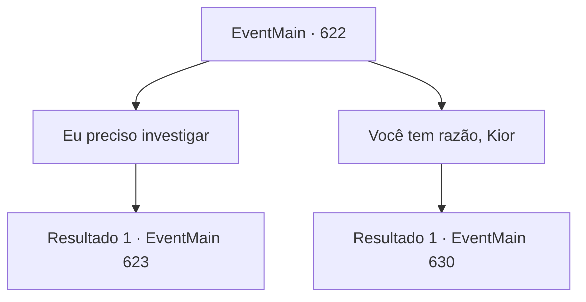

# Eventos principais · 622

[Índice da tabela](index.md) · [Índice geral](../index.md)

ID: `pt:EventMain:622` · Fonte: `EventMain4` · Versão: 1.2.47.

Mapeamento estático dos arquivos; a disponibilidade e a execução dependem do estado da run.

## Texto do evento

*Sem texto no arquivo.*

## Dados de entrada

```json
{
  "id": 622,
  "grade": 1,
  "normalGoal": "",
  "required": ""
}
```

## Mapa das escolhas



## Escolhas e resultados

### Escolha 1

Eu preciso investigar

Requisitos e outros campos da escolha:

```json
{
  "required": ""
}
```

#### Resultado 1.1

Você diz que precisa verificar e sair do esconderijo dos adoradores. Kior resmunga com você assim, mas isso não impede você de caminhar. 

 "Faça o que quiser. Isso não vai mudar nada."

 Você ignora a voz de Kior e segue para onde Donna mora. 

 A residência de Donna fica em uma montanha acidentada e alta chamada 'Muralha Verde'. Wyvern está voando sobre coníferas, e feras perigosas como cobras e lobos estão escondidas entre os arbustos. 

 "Você está lutando por nada... Você tem tempo suficiente para desperdiçar com algo tão inútil?"

 A voz de Kior é ouvida em sua cabeça, mas você a ignora e apressa seus passos. E não muito tempo depois, você encontra uma oficina onde a fumaça sobe pela chaminé.

Continuação registrada: [Evento 623](0623.md) na mesma tabela.

```json
{
  "required": "",
  "chance": "1",
  "nextEvent": 623,
  "type": 2,
  "reward": ""
}
```

### Escolha 2

Você tem razão, Kior

Requisitos e outros campos da escolha:

```json
{
  "required": ""
}
```

#### Resultado 2.1

Kior sorri como se estivesse satisfeito com suas palavras. E com uma voz encantadora, ele pede para você dar o fim a ela. 

 "Essa é a decisão certa. {1}. Coloque sua mão no rosto daquela garota. Assim você será capaz de absorver a alma."


Continuação registrada: [Evento 630](0630.md) na mesma tabela.

```json
{
  "required": "",
  "chance": "1",
  "nextEvent": 630,
  "type": 2,
  "reward": ""
}
```

## Referências que chegam a este evento

- [Evento 621 · escolha 1 · resultado 1](0621.md#escolha-1)
