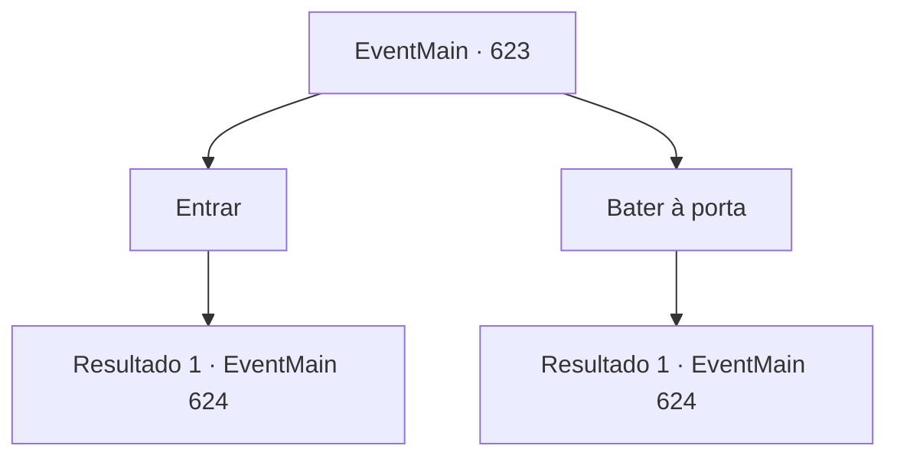

# Eventos principais · 623

[Índice da tabela](index.md) · [Índice geral](../index.md)

ID: `pt:EventMain:623` · Fonte: `EventMain4` · Versão: 1.2.47.

Mapeamento estático dos arquivos; a disponibilidade e a execução dependem do estado da run.

## Texto do evento

*Sem texto no arquivo.*

## Dados de entrada

```json
{
  "id": 623,
  "grade": 1,
  "normalGoal": "",
  "required": ""
}
```

## Mapa das escolhas



## Escolhas e resultados

### Escolha 1

Entrar

Requisitos e outros campos da escolha:

```json
{
  "required": ""
}
```

#### Resultado 1.1

Você abre cuidadosamente a porta e entra na oficina. A oficina é muito mais ampla do que o que você viu do lado de fora. No entanto, apesar de sua vastidão, a passagem é estreita, quase como uma parede de fortaleza, devido às pilhas de livros e bagunça acumulada. Eles estão empilhados tão alto que tocam o teto, muito mais alto do que a altura de um homem. Há uma passagem muito estreita por ela. Você caminha por um longo tempo e se perde na floresta bagunçada. Então, uma voz de mulher ressoa. 

 "Quem é você? Está mexendo nas oficinas dos outros sem pedir permissão?"


Continuação registrada: [Evento 624](0624.md) na mesma tabela.

```json
{
  "required": "",
  "chance": "1",
  "nextEvent": 624,
  "type": 2,
  "reward": ""
}
```

### Escolha 2

Bater à porta

Requisitos e outros campos da escolha:

```json
{
  "required": ""
}
```

#### Resultado 2.1

Você bate na porta da oficina várias vezes. Então a porta da oficina se abre, e livros e tralhas empilhadas como uma parede te recebem. Depois de um tempo, uma voz de mulher sai de algum lugar. 

 "Por que você vem a um lugar tão remoto?"


Continuação registrada: [Evento 624](0624.md) na mesma tabela.

```json
{
  "required": "",
  "chance": "1",
  "nextEvent": 624,
  "type": 2,
  "reward": ""
}
```

## Referências que chegam a este evento

- [Evento 622 · escolha 1 · resultado 1](0622.md#escolha-1)
