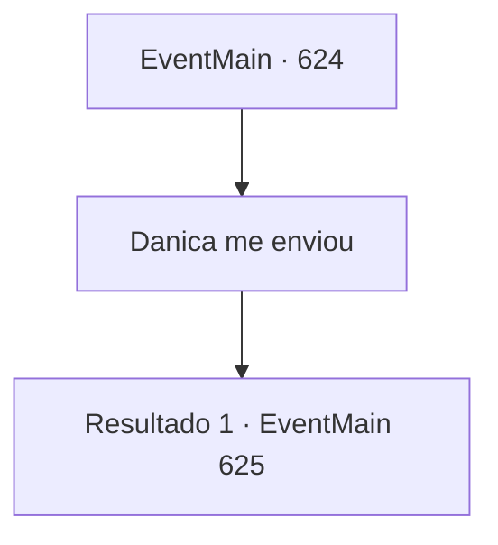

# Eventos principais · 624

[Índice da tabela](index.md) · [Índice geral](../index.md)

ID: `pt:EventMain:624` · Fonte: `EventMain4` · Versão: 1.2.47.

Mapeamento estático dos arquivos; a disponibilidade e a execução dependem do estado da run.

## Texto do evento

*Sem texto no arquivo.*

## Dados de entrada

```json
{
  "id": 624,
  "grade": 1,
  "normalGoal": "",
  "required": ""
}
```

## Mapa das escolhas



## Escolhas e resultados

### Escolha 1

Danica me enviou

Requisitos e outros campos da escolha:

```json
{
  "required": ""
}
```

#### Resultado 1.1

Você diz que veio aqui com a introdução de Danica. 

 "Espera um pouco..."

 Logo após as palavras da mulher serem ouvidas, a confusão começa a se mover. Conforme se movem para criar um caminho, uma mulher é vista alimentando o bebê Wyvern. Ela solta o Wyvern e se apresenta como 'Donna'. 

 "...então, o que te traz aqui?"

 Você pede a ela para emprestar um espelho da memória. Donna pondera momentaneamente o pedido, depois balança a cabeça tristemente. 

 "Desculpe, mas acho que isso será difícil. Houve um tempo em que a pessoa que o usava não conseguia sair do passado. É muito perigoso."


Continuação registrada: [Evento 625](0625.md) na mesma tabela.

```json
{
  "required": "",
  "chance": "1",
  "nextEvent": 625,
  "type": 2,
  "reward": ""
}
```

## Referências que chegam a este evento

- [Evento 623 · escolha 1 · resultado 1](0623.md#escolha-1)
- [Evento 623 · escolha 2 · resultado 1](0623.md#escolha-2)
