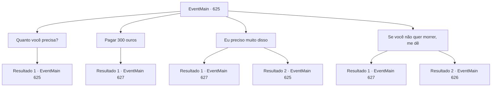

# Eventos principais · 625

[Índice da tabela](index.md) · [Índice geral](../index.md)

ID: `pt:EventMain:625` · Fonte: `EventMain4` · Versão: 1.2.47.

Mapeamento estático dos arquivos; a disponibilidade e a execução dependem do estado da run.

## Texto do evento

*Sem texto no arquivo.*

## Dados de entrada

```json
{
  "id": 625,
  "grade": 1,
  "normalGoal": "",
  "required": ""
}
```

## Mapa das escolhas



## Escolhas e resultados

### Escolha 1

Quanto você precisa?

Requisitos e outros campos da escolha:

```json
{
  "required": "5_395_0"
}
```

#### Resultado 1.1

Você pergunta a Donna quanto você pode emprestar. Mas ela balança a cabeça em resposta à sua pergunta. 

 "Um... Desculpe, mas ouro não é o problema. Não importa quanto você me dê... A vida de uma pessoa está em jogo"

 Donna fica embaçada no final de seu discurso.

Continuação registrada: [Evento 625](0625.md) na mesma tabela.

```json
{
  "required": "",
  "chance": "1",
  "nextEvent": 625,
  "type": 2,
  "reward": "5_395_1"
}
```

### Escolha 2

Pagar 300 ouros

Requisitos e outros campos da escolha:

```json
{
  "required": "5_395_1|1_4_300"
}
```

#### Resultado 2.1

Você dá 300 ouros para Donna, que balança a cabeça. Ela olha para o ouro no bolso e responde com voz trêmula. Parece ser muito dinheiro para rejeitar a oferta. 

 "Uh... Uh... Isso... Um momento, por favor."

 Depois de um tempo, Donna, que trouxe o espelho, entrega-o a você, explicando como usá-lo. O espelho da memória é um objeto colorido cercado por várias pedras preciosas como diamantes, rubis e safiras. 

 Você olha no espelho e pensa em sua casa. Duas cenas refletem no espelho. Uma é a cena em que Kior está te amaldiçoando. A outra parece ser Kior sussurrando algo para seu cônjuge.

Continuação registrada: [Evento 627](0627.md) na mesma tabela.

```json
{
  "required": "",
  "chance": "1",
  "nextEvent": 627,
  "type": 2,
  "reward": "0_4_-300|0_2_1"
}
```

### Escolha 3

Eu preciso muito disso

Requisitos e outros campos da escolha:

```json
{
  "required": "5_396_0"
}
```

#### Resultado 3.1

Você persuade Donna de que ainda precisa disso. Ela concorda impotente com sua persuasão sincera. 

 "Uh... Um momento, por favor."

 Depois de um tempo, Donna, que trouxe o espelho, entrega-o a você, explicando como usá-lo. O espelho da memória é um objeto colorido cercado por várias pedras preciosas como diamantes, rubis e safiras. 

 Você olha no espelho e pensa em sua casa. Duas cenas refletem no espelho. Uma é a cena em que Kior está te amaldiçoando. A outra parece Kior sussurrando algo para seu cônjuge.

Continuação registrada: [Evento 627](0627.md) na mesma tabela.

```json
{
  "required": "",
  "chance": "1|0_7_1",
  "nextEvent": 627,
  "type": 0,
  "reward": "0_2_1"
}
```

#### Resultado 3.2

Você tenta persuadir Donna, dizendo que ainda é necessário, mas ela apenas balança a cabeça. Então Kior sussurra. 

 "Eu te disse. É perda de tempo."


Continuação registrada: [Evento 625](0625.md) na mesma tabela.

```json
{
  "required": "",
  "chance": "14",
  "nextEvent": 625,
  "type": 1,
  "reward": "5_396_1"
}
```

### Escolha 4

Se você não quer morrer, me dê

Requisitos e outros campos da escolha:

```json
{
  "required": "2_3_15|5_397_0"
}
```

#### Resultado 4.1

Ameaças Donna para me dar um espelho se você não quiser morrer. Ela treme e concorda com suas ameaças severas. 

 "Uh... Uh... Isso... Um momento, por favor."

 Depois de um tempo, Donna, que trouxe o espelho, entrega-o a você, explicando como usá-lo. O espelho da memória é um objeto colorido cercado por várias pedras preciosas como diamantes, rubis e safiras. 

 Você olha no espelho e pensa em sua casa. Duas cenas refletem no espelho. Uma é a cena em que Kior está te amaldiçoando. A outra parece Kior sussurrando algo para seu cônjuge.

Continuação registrada: [Evento 627](0627.md) na mesma tabela.

```json
{
  "required": "",
  "chance": "1|0_12_1",
  "nextEvent": 627,
  "type": 0,
  "reward": "0_2_1|5_397_1"
}
```

#### Resultado 4.2

Você ameaça Donna para lhe dar um espelho se você não quiser morrer. Mas ela não cede às suas ameaças e apenas repete, dizendo que não pode dar. Finalmente, você fica com raiva e a acerta na cabeça. Depois que Donna desmaia, você procura na oficina e tenta encontrar um espelho da memória. Mas tudo o que você vê é um livro ou lixo que você não consegue ler. Então, a voz de Kior é ouvida na minha cabeça. 

 "Você perdeu tempo suficiente, então agora você ficará satisfeito, certo? Agora, volte e dedique a alma de Danica a mim"

.

Continuação registrada: [Evento 626](0626.md) na mesma tabela.

```json
{
  "required": "",
  "chance": "14",
  "nextEvent": 626,
  "type": 1,
  "reward": "0_3_-5|5_397_1"
}
```

## Referências que chegam a este evento

- [Evento 624 · escolha 1 · resultado 1](0624.md#escolha-1)
- [Evento 625 · escolha 1 · resultado 1](0625.md#escolha-1)
- [Evento 625 · escolha 3 · resultado 2](0625.md#escolha-3)
