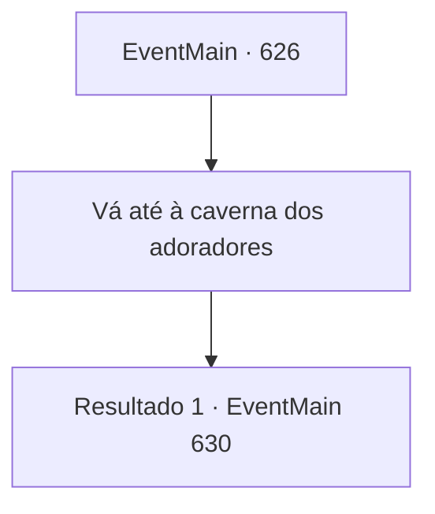

# Eventos principais · 626

[Índice da tabela](index.md) · [Índice geral](../index.md)

ID: `pt:EventMain:626` · Fonte: `EventMain4` · Versão: 1.2.47.

Mapeamento estático dos arquivos; a disponibilidade e a execução dependem do estado da run.

## Texto do evento

*Sem texto no arquivo.*

## Dados de entrada

```json
{
  "id": 626,
  "grade": 1,
  "normalGoal": "",
  "required": ""
}
```

## Mapa das escolhas



## Escolhas e resultados

### Escolha 1

Vá até à caverna dos adoradores

Requisitos e outros campos da escolha:

```json
{
  "required": ""
}
```

#### Resultado 1.1

Alguns dias depois, quando você chega na caverna, você visita a prisão onde Danica está. Lagando impotente na prisão, ela olha para cima para a sua popularidade. 

 "O que aconteceu?"

 Você se aproxima silenciosamente dela sem responder à pergunta. Então, o sussurro de Kior é ouvido novamente. 

 "Coloque sua mão na cabeça e sugue a alma."


Continuação registrada: [Evento 630](0630.md) na mesma tabela.

```json
{
  "required": "",
  "chance": "1",
  "nextEvent": 630,
  "type": 2,
  "reward": ""
}
```

## Referências que chegam a este evento

- [Evento 625 · escolha 4 · resultado 2](0625.md#escolha-4)
