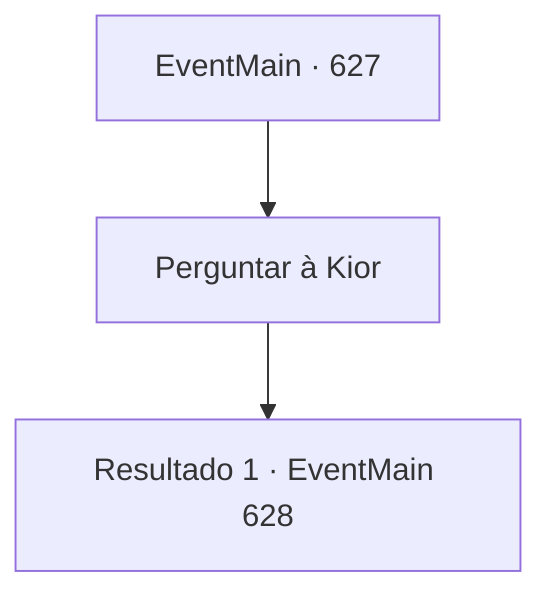

# Eventos principais · 627

[Índice da tabela](index.md) · [Índice geral](../index.md)

ID: `pt:EventMain:627` · Fonte: `EventMain4` · Versão: 1.2.47.

Mapeamento estático dos arquivos; a disponibilidade e a execução dependem do estado da run.

## Texto do evento

*Sem texto no arquivo.*

## Dados de entrada

```json
{
  "id": 627,
  "grade": 1,
  "normalGoal": "",
  "required": ""
}
```

## Mapa das escolhas



## Escolhas e resultados

### Escolha 1

Perguntar à Kior

Requisitos e outros campos da escolha:

```json
{
  "required": ""
}
```

#### Resultado 1.1

Você interroga Kior e pergunta o que aconteceu. 

 "Hmm... É como você viu. Eu coloquei uma maldição em você e fiz um acordo com seu cônjuge."

 Kior orgulhosamente admite a cena no espelho e continua a falar. 

 "Mas e daí? Eu queimei sua família até a morte? Não. Eu só precisava de você e de sua família. Eu queria que você fosse um crente em meus braços. Então, é o trabalho de pessoas loucas que acreditam totalmente em Tere que mataram sua família."

 Kior diz que nada mudou e ainda diz que vai te ajudar.

Continuação registrada: [Evento 628](0628.md) na mesma tabela.

```json
{
  "required": "",
  "chance": "1",
  "nextEvent": 628,
  "type": 2,
  "reward": ""
}
```

## Referências que chegam a este evento

- [Evento 625 · escolha 2 · resultado 1](0625.md#escolha-2)
- [Evento 625 · escolha 3 · resultado 1](0625.md#escolha-3)
- [Evento 625 · escolha 4 · resultado 1](0625.md#escolha-4)
