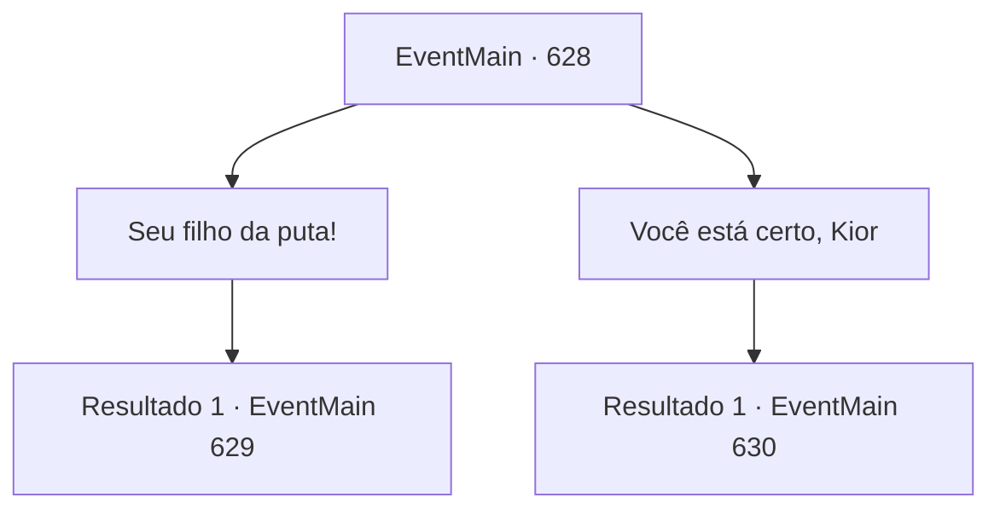

# Eventos principais · 628

[Índice da tabela](index.md) · [Índice geral](../index.md)

ID: `pt:EventMain:628` · Fonte: `EventMain4` · Versão: 1.2.47.

Mapeamento estático dos arquivos; a disponibilidade e a execução dependem do estado da run.

## Texto do evento

*Sem texto no arquivo.*

## Dados de entrada

```json
{
  "id": 628,
  "grade": 1,
  "normalGoal": "",
  "required": ""
}
```

## Mapa das escolhas



## Escolhas e resultados

### Escolha 1

Seu filho da puta!

Requisitos e outros campos da escolha:

```json
{
  "required": ""
}
```

#### Resultado 1.1

Kior, quem te deu uma mãozinha, é o principal culpado pela morte da sua família. Você não consegue conter sua raiva. Você vomita abusos e balança o punho no ar. No entanto, longe de acertar Kior, sua voz cheia de ridicularização é ouvida. 

 "Você vai me trair? Você é bobo. Então não tenho escolha a não ser encerrar meu contrato com você."

 Naquele momento, você tropeça, sentindo o poder de Kior em seu corpo desaparecendo. Suas mãos e pés tremem, e sua visão fica momentaneamente embaçada. 

 "Eu te ajudei até agora, te salvando da morte... Agora você tem apenas alguns dias restantes. Faça bem."

 No final da frase, sua voz não é mais ouvida. Você não consegue sentir sua presença o tempo todo. E a escuridão profunda chega.

Continuação registrada: [Evento 629](0629.md) na mesma tabela.

```json
{
  "required": "",
  "chance": "1",
  "nextEvent": 629,
  "type": 2,
  "reward": "0_5_-1|0_6_-1|0_13_-1|0_3_20|5_431_1"
}
```

### Escolha 2

Você está certo, Kior

Requisitos e outros campos da escolha:

```json
{
  "required": ""
}
```

#### Resultado 2.1

Você concorda com Kior. Certamente, Kior usou você, mas Teretian matou diretamente sua família. 

 "Você perdeu tempo suficiente, então agora você ficará satisfeito, certo? Bem, é hora de cumprir o contrato. {1}. Dedique a alma de Danica a mim."

 Nas palavras de Kior, você quebra o espelho e o deixa lá. Há uma voz perplexa de Donna atrás de você, mas você a ignora.

 Você retorna à caverna dos adoradores e visita Danica. Preso impotente na prisão, ela olha para cima para a sua popularidade. 

 "O que aconteceu?"

 Você se aproxima silenciosamente dela sem responder à pergunta. Então, o sussurro de Kior é ouvido novamente. 

 "Coloque sua mão na cabeça e sugue a alma."


Continuação registrada: [Evento 630](0630.md) na mesma tabela.

```json
{
  "required": "",
  "chance": "1",
  "nextEvent": 630,
  "type": 2,
  "reward": ""
}
```

## Referências que chegam a este evento

- [Evento 627 · escolha 1 · resultado 1](0627.md#escolha-1)
