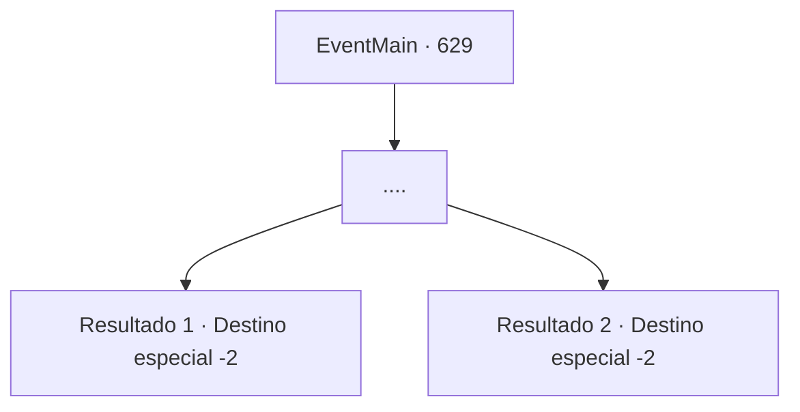

# Eventos principais · 629

[Índice da tabela](index.md) · [Índice geral](../index.md)

ID: `pt:EventMain:629` · Fonte: `EventMain4` · Versão: 1.2.47.

Mapeamento estático dos arquivos; a disponibilidade e a execução dependem do estado da run.

## Texto do evento

*Sem texto no arquivo.*

## Dados de entrada

```json
{
  "id": 629,
  "grade": 1,
  "normalGoal": "",
  "required": ""
}
```

## Mapa das escolhas



## Escolhas e resultados

### Escolha 1

....

Requisitos e outros campos da escolha:

```json
{
  "required": ""
}
```

#### Resultado 1.1

Em certo momento, você recobra os sentidos com o líquido refrescante descendo pela sua garganta. Você abre os olhos lentamente. Você pode ver o rosto de Donna suspirando aliviada. 

 "Ufa. O que aconteceu? Você desmaiou de repente, então eu usei a 'Água da Vida'!"

 Ela diz que a água da vida é um elixir valioso que até mesmo faria uma vaca quase morta pular de vida. Você respira fundo e explica a situação para ela. Ao ouvir sua situação, Donna assume uma expressão séria e tenta falar com voz calma. 

 "Você conseguirá durar dois ou três meses no mínimo, ou seis meses no máximo... Temos que nos apressar para pegar a Danica. Tenho certeza de que o demônio usará a mão dele. Vou chamar reforços e esperar em 'Merlden Hill'. Nos vemos lá."

 Ela se esconde em algum lugar na oficina antes que você possa responder. Você sai do local e segue em direção a Merlden Hill.

Continuação registrada: [Destino especial `-2`](../destinos-especiais.md).

```json
{
  "required": "18_397_1",
  "chance": "1",
  "nextEvent": -2,
  "type": 2,
  "reward": "13_4_9"
}
```

#### Resultado 1.2

Em certo momento, você recobra os sentidos com o líquido refrescante descendo pela sua garganta. Você abre os olhos lentamente. Você pode ver o rosto de Donna suspirando aliviada. 

 "Ufa. O que aconteceu? Você desmaiou de repente, então eu usei a 'Água da Vida'!"

 Ela diz que a água da vida é um elixir valioso que até mesmo faria uma vaca quase morta pular de vida. Você respira fundo e explica a situação para ela. Ao ouvir sua situação, Donna assume uma expressão séria e tenta falar com voz calma. 

 "Você conseguirá durar dois ou três meses no mínimo, ou seis meses no máximo... Temos que nos apressar para pegar a Danica. Tenho certeza de que o demônio usará a mão dele. Vou chamar reforços e esperar em 'Merlden Hill'. Nos vemos lá."

 Ela se esconde em algum lugar na oficina antes que você possa responder. Você sai do local e segue em direção a Merlden Hill.

Continuação registrada: [Destino especial `-2`](../destinos-especiais.md).

```json
{
  "required": "5_397_1",
  "chance": "1",
  "nextEvent": -2,
  "type": 2,
  "reward": "13_4_9|0_4_-300"
}
```

## Referências que chegam a este evento

- [Evento 628 · escolha 1 · resultado 1](0628.md#escolha-1)
