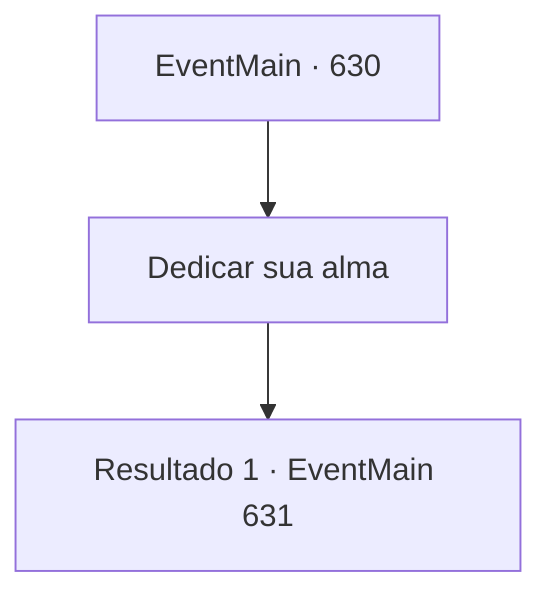

# Eventos principais · 630

[Índice da tabela](index.md) · [Índice geral](../index.md)

ID: `pt:EventMain:630` · Fonte: `EventMain4` · Versão: 1.2.47.

Mapeamento estático dos arquivos; a disponibilidade e a execução dependem do estado da run.

## Texto do evento

*Sem texto no arquivo.*

## Dados de entrada

```json
{
  "id": 630,
  "grade": 1,
  "normalGoal": "",
  "required": ""
}
```

## Mapa das escolhas



## Escolhas e resultados

### Escolha 1

Dedicar sua alma

Requisitos e outros campos da escolha:

```json
{
  "required": ""
}
```

#### Resultado 1.1

Você coloca sua mão em seu rosto, como Kior disse. Então uma névoa pálida e densa flui de todos os buracos no rosto de Danica. É a alma dela. 

 "Espera!"

 Logo depois de absorver toda a alma de Danica e retirar suas mãos, ela para de respirar. Pouco depois disso, Gess se aproxima e diz, curvando-se. 

 "O que, o que você vai fazer agora? Você precisa fazer um plano..."

 Danica foi morta, mas você ainda tinha mais dois alvos para vingar. Então, de repente, com um grito vindo de fora, um som parecia desabar. 

 "São os paladinos de Tere! Os paladinos atacaram!"

 Gess olha para você com uma expressão perplexa diante do grito.

Continuação registrada: [Evento 631](0631.md) na mesma tabela.

```json
{
  "required": "",
  "chance": "1",
  "nextEvent": 631,
  "type": 2,
  "reward": ""
}
```

## Referências que chegam a este evento

- [Evento 621 · escolha 2 · resultado 1](0621.md#escolha-2)
- [Evento 622 · escolha 2 · resultado 1](0622.md#escolha-2)
- [Evento 626 · escolha 1 · resultado 1](0626.md#escolha-1)
- [Evento 628 · escolha 2 · resultado 1](0628.md#escolha-2)
