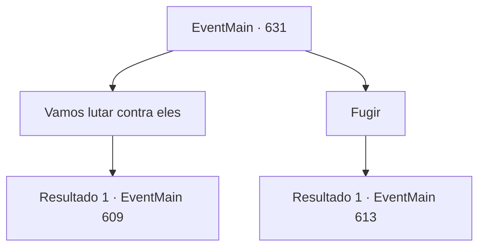

# Eventos principais · 631

[Índice da tabela](index.md) · [Índice geral](../index.md)

ID: `pt:EventMain:631` · Fonte: `EventMain4` · Versão: 1.2.47.

Mapeamento estático dos arquivos; a disponibilidade e a execução dependem do estado da run.

## Texto do evento

*Sem texto no arquivo.*

## Dados de entrada

```json
{
  "id": 631,
  "grade": 1,
  "normalGoal": "",
  "required": ""
}
```

## Mapa das escolhas



## Escolhas e resultados

### Escolha 1

Vamos lutar contra eles

Requisitos e outros campos da escolha:

```json
{
  "required": ""
}
```

#### Resultado 1.1

Você saca sua arma para revidar. Então Gess te impede com uma expressão confusa. 

 "F, Lutar é... O confronto direto ga, jogo será em uma des, desvantagem."

 Os paladinos nos atacam imediatamente porque eles têm poder suficiente, Gess diz que precisamos de uma estratégia mesmo se lutarmos.

Continuação registrada: [Evento 609](0609.md) na mesma tabela.

```json
{
  "required": "",
  "chance": "1",
  "nextEvent": 609,
  "type": 2,
  "reward": ""
}
```

### Escolha 2

Fugir

Requisitos e outros campos da escolha:

```json
{
  "required": ""
}
```

#### Resultado 2.1

Você arruma sua mochila, dizendo vamos fugir. Então Gess te para com uma expressão aflita. 

 "Eles devem estar cercados por nós."

 Os paladinos nos atacam imediatamente porque eles têm poder suficiente, Gess diz que precisamos de uma estratégia mesmo se fugirmos.

Continuação registrada: [Evento 613](0613.md) na mesma tabela.

```json
{
  "required": "",
  "chance": "1",
  "nextEvent": 613,
  "type": 2,
  "reward": ""
}
```

## Referências que chegam a este evento

- [Evento 630 · escolha 1 · resultado 1](0630.md#escolha-1)
