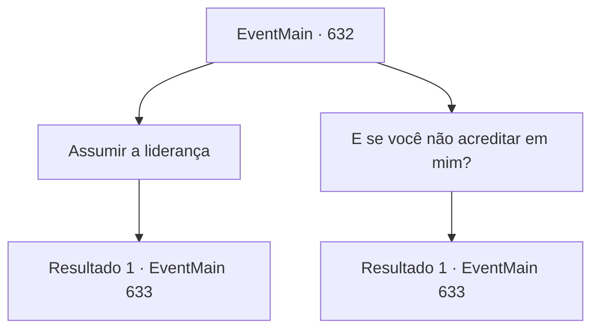

# Eventos principais · 632

[Índice da tabela](index.md) · [Índice geral](../index.md)

ID: `pt:EventMain:632` · Fonte: `EventMain4` · Versão: 1.2.47.

Mapeamento estático dos arquivos; a disponibilidade e a execução dependem do estado da run.

## Texto do evento

Ao chegar na Colina Merlden, você recuou ao ver o reforço trazido por Donna. O que a acompanhava eram cavaleiros da Ordem de Teresia.    Os cavaleiros sacaram suas armas assim que o avistaram, e Donna, desesperada, correu para impedi-los, gritando:   

 "Espere! Não é hora para isso! Precisamos unir forças para resgatar Danica! Se {1} não estiver conosco, não saberemos onde ela está! Não é mesmo?"

    Em resposta à sua pergunta, a cavaleira de cabelo vermelho, que estava na frente dos cavaleiros, falou com firmeza:   

 "Como podemos confiar em alguém que, em algum momento, adorou demônios?"

   Ela o encarou com desconfiança, mantendo a mão sobre a lâmina de sua espada, pronta para sacar a qualquer momento.  

## Dados de entrada

```json
{
  "id": 632,
  "grade": 1,
  "normalGoal": "",
  "required": "1_2_75|13_4_9"
}
```

## Mapa das escolhas



## Escolhas e resultados

### Escolha 1

Assumir a liderança

Requisitos e outros campos da escolha:

```json
{
  "required": ""
}
```

#### Resultado 1.1

Em vez de responder, você lidera o caminho para a caverna dos adoradores. 

 "Valen... Primeiro de tudo, salvar Danica, certo?"

 Com sua atitude e persuasão de Donna, o paladino Valen coloca a espada. Então siga silenciosamente seus passos. 

 Quando você e os paladinos chegam, a caverna dos adoradores está silenciosa. Não apenas o exterior, mas também o interior está vazio. Olhando ao redor com um olhar afiado, Valen olha para você desta vez e diz. 

 "Hmm... Ele deve ter mudado seu esconderijo novamente. É um truque comum. Procure por vestígios também."


Continuação registrada: [Evento 633](0633.md) na mesma tabela.

```json
{
  "required": "",
  "chance": "1",
  "nextEvent": 633,
  "type": 2,
  "reward": ""
}
```

### Escolha 2

E se você não acreditar em mim?

Requisitos e outros campos da escolha:

```json
{
  "required": ""
}
```

#### Resultado 2.1

Você responde agressivamente a ela. Então a testa de Paladin se enruga um pouco. Andando em ovos no meio, Donna pega sua manga e diz. 

 "Valen... Primeiro de tudo, salvar Danica, certo?"

 Com sua atitude e persuasão de Donna, Paladin, Valen, coloca a espada. Então siga silenciosamente seus passos. 

 Quando você e os paladinos chegam, a caverna dos adoradores está silenciosa. Não apenas o exterior, mas também o interior está vazio. Olhando ao redor com um olhar afiado, Valen olha para você desta vez e diz. 

 "Você não esperava por isso. Parece que eles mudaram seu esconderijo. Apresse-se e procure por pistas."


Continuação registrada: [Evento 633](0633.md) na mesma tabela.

```json
{
  "required": "",
  "chance": "1",
  "nextEvent": 633,
  "type": 2,
  "reward": ""
}
```

## Referências que chegam a este evento

Nenhum `nextEvent` positivo da mesma tabela aponta para este nó. Isso não prova que seja inacessível: sorteio e estado de história podem selecioná-lo.

