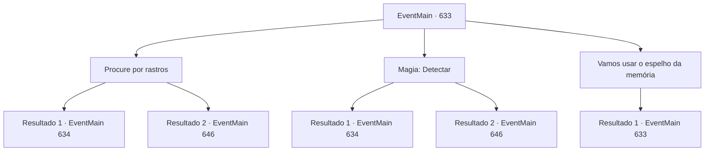

# Eventos principais · 633

[Índice da tabela](index.md) · [Índice geral](../index.md)

ID: `pt:EventMain:633` · Fonte: `EventMain4` · Versão: 1.2.47.

Mapeamento estático dos arquivos; a disponibilidade e a execução dependem do estado da run.

## Texto do evento

*Sem texto no arquivo.*

## Dados de entrada

```json
{
  "id": 633,
  "grade": 1,
  "normalGoal": "",
  "required": ""
}
```

## Mapa das escolhas



## Escolhas e resultados

### Escolha 1

Procure por rastros

Requisitos e outros campos da escolha:

```json
{
  "required": ""
}
```

#### Resultado 1.1

Você procura ao redor da caverna por vestígios de adoradores. Felizmente, as pegadas dos adoradores permanecem perto da saída. Você segue as pegadas e se move para o que acredita ser o novo esconderijo deles. Os paladinos calmamente te seguem como se não tivessem encontrado nenhum outro vestígio.

 Você caminha por uma pequena vila e encontra um novo esconderijo para os adoradores no fundo do cânion. Eles se preparam para algo indo e voltando entre as estreitas fendas entre os penhascos. 

 "Estão ali. Todos prontos. Prontos para atacar."

 Quando Valen fala enquanto desembainha sua espada, os paladinos também sacam suas armas e se preparam para atacar.

Continuação registrada: [Evento 634](0634.md) na mesma tabela.

```json
{
  "required": "",
  "chance": "1|0_14_1",
  "nextEvent": 634,
  "type": 0,
  "reward": "0_2_1"
}
```

#### Resultado 1.2

Você procura perto da caverna por vestígios de adoradores. No entanto, apenas restos ou roupas são encontrados, e nada pode ser encontrado para ajudar a rastreá-los. Pode ser o mesmo para os Cavaleiros Sagrados, mas a busca terminou com pouco resultado. Eventualmente, a perseguição aos adoradores não avança até quatro dias depois, quando Donna usa um espelho de memória. Isso ocorre porque levou tempo para o espelho carregar o poder para usar magia. 

 Você e os paladinos assistem às suas memórias e depois seguem para o novo esconderijo dos adoradores. Enquanto isso, você vê uma pequena vila. Era uma vila, para ser exato. Os corpos das pessoas estão espalhados desde a entrada da vila, e os prédios estão queimados ou desabados. Um dos demônios, o Hezrous, ocupa e se estabelece lá. 

 "Todos. Prontos para atacar!"

 Valen saca sua espada ao ver demônios brincando com os corpos das pessoas. E quando ela dá o sinal, os paladinos avançam para conquistar o mal.

Continuação registrada: [Evento 646](0646.md) na mesma tabela.

```json
{
  "required": "",
  "chance": "13",
  "nextEvent": 646,
  "type": 1,
  "reward": "6_0_152",
  "place": 4
}
```

### Escolha 2

Magia: Detectar

Requisitos e outros campos da escolha:

```json
{
  "required": "20_0_1|1_1_2"
}
```

#### Resultado 2.1

Você conjura Detectar e encontra vestígios dos adoradores deixados perto da caverna. Você os persegue e se move para o que você acredita ser o novo esconderijo deles. Os paladinos calmamente te seguem como se não tivessem encontrado nenhum outro vestígio.

 Você caminha por uma pequena vila e encontra um novo esconderijo para os adoradores no fundo do cânion. Eles se preparam para algo indo e voltando entre as estreitas fendas entre os penhascos do cânion. 

 "Eles estão ali. Todos prontos. Prontos para atacar."

 Quando Valen fala enquanto desembainha sua espada, os paladinos também sacam suas armas e se preparam para atacar.

Continuação registrada: [Evento 634](0634.md) na mesma tabela.

```json
{
  "required": "",
  "chance": "1|0_7_1|0_12_1",
  "nextEvent": 634,
  "type": 0,
  "reward": "0_2_1|0_1_-1"
}
```

#### Resultado 2.2

Você conjura Detectar para encontrar vestígios dos adoradores deixados perto da caverna. No entanto, apenas restos ou roupas foram encontrados, e nada pôde ser encontrado para ajudar a rastreá-los. Pode ser o mesmo para os Cavaleiros Sagrados, mas a busca terminou com pouco resultado. Eventualmente, perseguir os adoradores não avança até quatro dias depois, quando Donna usa um espelho de memória. Isso ocorre porque levou tempo para o espelho carregar o poder para usar magia. 

 Você e os paladinos assistem às memórias dos adoradores e depois seguem para o novo esconderijo deles. Enquanto isso, você vê uma pequena vila. Era uma vila, para ser exato. Os corpos das pessoas estão espalhados desde a entrada da vila, e os prédios estão queimados ou desabados. Um dos demônios, o Hezrous, ocupa e se estabelece lá. 

 "Todos. Prontos para atacar!"

 Valen desembainha sua espada ao ver demônios brincando com os corpos das pessoas. E quando ela faz um sinal, os Paladinos avançam para conquistar o mal.

Continuação registrada: [Evento 646](0646.md) na mesma tabela.

```json
{
  "required": "",
  "chance": "13",
  "nextEvent": 646,
  "type": 1,
  "reward": "6_0_152",
  "place": 4
}
```

### Escolha 3

Vamos usar o espelho da memória

Requisitos e outros campos da escolha:

```json
{
  "required": "5_398_0"
}
```

#### Resultado 3.1

Você sugere que Donna use o espelho da memória. Mas Donna responde, balançando a cabeça. 

 "Hmm. Receio que o mana não tenha sido preenchido desde a última vez que você usou. Acho que terá que esperar mais quatro dias."

 Ela diz que o artefato semelhante a um espelho da memória usa uma quantidade tremenda de mana toda vez, então você precisa esperar alguns dias depois de usá-lo. Em sua explicação, você concorda com a cabeça e tenta encontrar vestígios dos adoradores por si mesmo.

Continuação registrada: [Evento 633](0633.md) na mesma tabela.

```json
{
  "required": "",
  "chance": "1",
  "nextEvent": 633,
  "type": 2,
  "reward": "5_398_1"
}
```

## Referências que chegam a este evento

- [Evento 632 · escolha 1 · resultado 1](0632.md#escolha-1)
- [Evento 632 · escolha 2 · resultado 1](0632.md#escolha-2)
- [Evento 633 · escolha 3 · resultado 1](0633.md#escolha-3)
