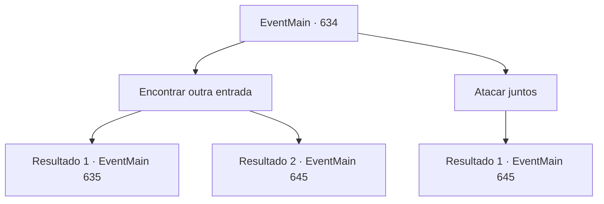

# Eventos principais · 634

[Índice da tabela](index.md) · [Índice geral](../index.md)

ID: `pt:EventMain:634` · Fonte: `EventMain4` · Versão: 1.2.47.

Mapeamento estático dos arquivos; a disponibilidade e a execução dependem do estado da run.

## Texto do evento

*Sem texto no arquivo.*

## Dados de entrada

```json
{
  "id": 634,
  "grade": 1,
  "normalGoal": "",
  "required": ""
}
```

## Mapa das escolhas



## Escolhas e resultados

### Escolha 1

Encontrar outra entrada

Requisitos e outros campos da escolha:

```json
{
  "required": ""
}
```

#### Resultado 1.1

Logo antes dos Paladinos avançarem, você os para e procura por outra entrada. Isso porque os adoradores são tão espertos que eles mudam seus esconderijos toda vez, então você prevê que eles teriam feito outros caminhos. E sua previsão está correta. Uma rachadura escondida perto da entrada do desfiladeiro, que é coberta por uma grande pedra. Há uma pequena lâmpada pendurada nela, e Donna diz enquanto olha para ela. 

 "Eu acho que é um caminho para o subterrâneo... Pode haver uma armadilha. O que devemos fazer?"

 Nessa palavra, Valen sugere uma operação. Se você for sozinho no corredor e voltar após a reconhecimento, então os paladinos entrarão. Donna discorda, dizendo que é muito perigoso, mas Valen pede sua opinião com uma expressão vazia. 

 "Você não pode fazer isso?"


Continuação registrada: [Evento 635](0635.md) na mesma tabela.

```json
{
  "required": "",
  "chance": "1|0_7_1",
  "nextEvent": 635,
  "type": 0,
  "reward": ""
}
```

#### Resultado 1.2

Logo antes dos Paladinos avançarem, você os para e procura por outra entrada. Isso ocorre porque os adoradores são tão espertos que eles mudam seus esconderijos toda vez, então você prevê que eles teriam feito outros caminhos. Mas mesmo se você olhar por todo o desfiladeiro, não consegue encontrar outra passagem. Valen olha para você com olhos frios e vira a cabeça imediatamente. 

 "Que desperdício de tempo. Todos! Avancem!"

 Com o avanço dos paladinos, você também se apressa em direção aos adoradores do demônio.

Continuação registrada: [Evento 645](0645.md) na mesma tabela.

```json
{
  "required": "",
  "chance": "15",
  "nextEvent": 645,
  "type": 1,
  "reward": "6_3_71",
  "place": 6
}
```

### Escolha 2

Atacar juntos

Requisitos e outros campos da escolha:

```json
{
  "required": ""
}
```

#### Resultado 2.1

Você avança contra os adoradores do demônio com o Corpo de Paladinos. Os adoradores, que estavam se preparando para algo, não conseguem resistir ao serem atingidos pelo ataque dos paladinos. 

 "Não deixem nenhum para trás!"

 A voz de Valen ressoa alto no desfiladeiro.

Continuação registrada: [Evento 645](0645.md) na mesma tabela.

```json
{
  "required": "",
  "chance": "1",
  "nextEvent": 645,
  "type": 2,
  "reward": "6_3_71",
  "place": 6
}
```

## Referências que chegam a este evento

- [Evento 633 · escolha 1 · resultado 1](0633.md#escolha-1)
- [Evento 633 · escolha 2 · resultado 1](0633.md#escolha-2)
