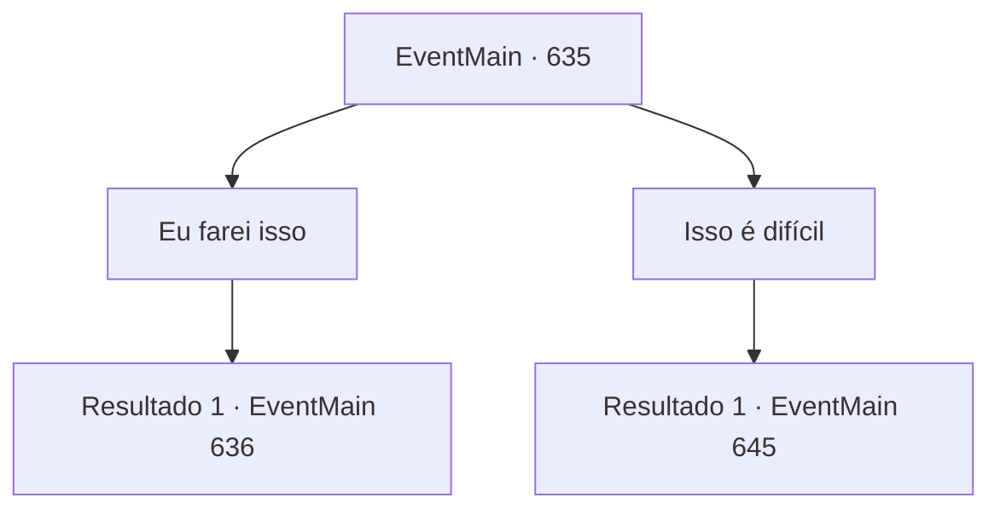

# Eventos principais · 635

[Índice da tabela](index.md) · [Índice geral](../index.md)

ID: `pt:EventMain:635` · Fonte: `EventMain4` · Versão: 1.2.47.

Mapeamento estático dos arquivos; a disponibilidade e a execução dependem do estado da run.

## Texto do evento

*Sem texto no arquivo.*

## Dados de entrada

```json
{
  "id": 635,
  "grade": 1,
  "normalGoal": "",
  "required": ""
}
```

## Mapa das escolhas



## Escolhas e resultados

### Escolha 1

Eu farei isso

Requisitos e outros campos da escolha:

```json
{
  "required": ""
}
```

#### Resultado 1.1

Você entra cuidadosamente nas rachaduras, dizendo que o faz. Você caminha devagar com as mãos na parede. Está bastante escuro e úmido, e o chão está lamacento, tornando-o um lugar inconveniente para caminhar. Um vento sinistro passa por você e carrega a voz de alguém. 

 "...Grande... Por favor...!"

 Você finalmente chega ao final do corredor, para de caminhar e olha a cena à sua frente. Você pode ver uma sala cheia de esqueletos e velas, Danica deitada no altar e Gess gritando algo. Sentindo um sinal, Gess olha para trás para você e torce o rosto. 

 "Oh! Você, você é um trai,traiçoeiro!"

 No momento, a capa que ele cobria flutua, e braços cheios de escuridão se estendem.

Continuação registrada: [Evento 636](0636.md) na mesma tabela.

```json
{
  "required": "",
  "chance": "1",
  "nextEvent": 636,
  "type": 2,
  "reward": "6_0_156",
  "place": 6
}
```

### Escolha 2

Isso é difícil

Requisitos e outros campos da escolha:

```json
{
  "required": ""
}
```

#### Resultado 2.1

Quando você diz não, Valen suspira silenciosamente. E chama quatro homens para guardar a passagem que você encontrou. 

 "Se bloquearmos aqui, poderemos impedi-los de fugir. Então eu os atacarei pela frente, como planejei."

 Após conversar, Valen saca uma espada e fica na frente de seus homens. 

 "Todos! Avançar!"

 Com o avanço dos paladinos, você também corre em direção aos adoradores de demônios.

Continuação registrada: [Evento 645](0645.md) na mesma tabela.

```json
{
  "required": "",
  "chance": "1",
  "nextEvent": 645,
  "type": 2,
  "reward": "6_3_71",
  "place": 6
}
```

## Referências que chegam a este evento

- [Evento 634 · escolha 1 · resultado 1](0634.md#escolha-1)
